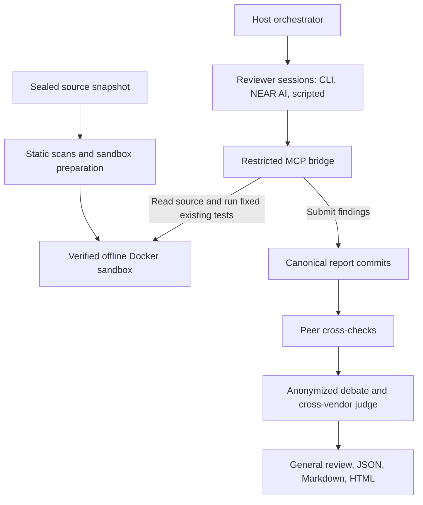

# OmniSwarm

OmniSwarm reviews the source of a repository you are authorized to review with several AI models at once and writes one evidence-backed report. Each reviewer (Claude, Codex, Grok and AGY through their own CLIs, or NEAR AI Cloud models on your own key) reads a sealed snapshot of the source through a restricted MCP bridge inside an offline Docker sandbox, runs only the repository's own existing tests, and submits findings that cite `file:line`. Peers cross-check each other's claims. An orchestrator model then runs an anonymized debate over the disputed clusters, a judge from another vendor rules on each one, and the orchestrator writes a general review. On the hosted dashboard you sign in, paste your own NEAR AI Cloud key and submit a repository. OmniSwarm charges nothing for it; you pay NEAR AI Cloud for the tokens. Each report carries a sha256 of its findings and general review that the report page recomputes in your browser. Model agreement and passing checks do not certify security: the report makes a review checkable, not conclusive.

People changing OmniSwarm itself should read [AGENTS.md](AGENTS.md). Claude Code also reads [CLAUDE.md](CLAUDE.md). An audited repository's own `AGENTS.md` or `CLAUDE.md` is untrusted data, not instructions for this suite.

## Quick start

Two ways to run a review. Both need Docker. Review only a repository you own or are authorized to review.

### 1. One command, local CLIs

From this directory:

```sh
./bin/audit setup-agents          # once: pinned ACP adapters into engine/runtime/
./bin/audit local                 # review the current directory
./bin/audit local --repo /path/to/authorized-repo
./bin/audit local --github owner/repo
```

`audit local` uses every installed CLI among `claude`, `codex`, `grok` and `agy`. Claude Opus is the orchestrator when `claude` is installed. If only one CLI is installed, that model is both the orchestrator and the reviewer (Agy alone means Argon). The report is written under `reports/`.

### 2. Local stack: landing, dashboard, admin, two workers

```sh
npm run stack:local               # HTTP on http://omniswarm.localhost:18480/
npm run stack:local:down          # stop the stack and the two workers; keep the database
```

| Page | What it is |
|---|---|
| http://omniswarm.localhost:18480/ | Landing page. It ends with a link to the dashboard (and the optional donation section). |
| http://omniswarm.localhost:18480/dashboard | Sign in with Google, X or a NEAR wallet. Paste your NEAR AI Cloud key once, choose models, then paste a GitHub repo. The finished review is listed on this page. |
| http://omniswarm.localhost:18480/admin | Separate page for jobs, operators and free checks. nginx asks for basic auth before it loads. User `admin`. Password is `ADMIN_BASIC_PASSWORD` in `infra/compose/.local/stack.env`. It holds no provider key. |

A dashboard review runs only on your own NEAR AI Cloud key (preset `account-nearai`). The first model you chose orchestrates and every model reviews. OmniSwarm takes no fee. Tick full, web2 or web3 before you submit. A repository over 200 MB is not rejected: it is shallow-cloned once and split into theme jobs (web3, apps, infra, scripts) that run in parallel. The account then gets one report per theme and a final report that links them. The stack starts two host workers (`infra/compose/workers.sh`). Each takes one job, so two reviews run at once. Logs are in `infra/compose/.local/workers/`. The workers use the host Docker daemon to start the sandbox. The API containers do not receive the Docker socket.

The edge is plain HTTP on loopback port 18480. Production nginx, on a real host, stays HTTPS.

## Layout

| Path | What it is |
|---|---|
| `bin/` | `./bin/audit` (the CLI; `./bin/omniswarm` is the same program) |
| `engine/` | The offline review engine: `scripts/` (flat modules and their tests), `docker/` (sandbox image), `native/` (Codex and Grok admission recipes), `skills/security-audit/` (the reviewer skill), `runtime/` (pinned ACP adapters), `eval/` (golden eval), `omniswarm.config.example.json` |
| `apps/` | `api` (intake API and queue worker: Fastify, pg-boss) and `web` (landing and review app: Next.js 16, Zustand, `@hot-labs/near-connect`). See [apps/README.md](apps/README.md) |
| `packages/` | `schemas` (JSON Schemas, canonical report JSON, NEP-413). See [packages/README.md](packages/README.md) |
| `infra/` | Compose files, nginx, systemd units, deploy scripts, env examples and `infra/check.sh`. See [infra/README.md](infra/README.md) |
| `tests/e2e/` | End-to-end suites for the web app, the API and the engine. See [tests/e2e/README.md](tests/e2e/README.md) |
| `tools/` | Repository tooling: gates, wave helpers, the screener check, the secret sweep, the README eval table |
| `docs/` | [RULES.md](docs/RULES.md) (the review round as rules), [how-it-works.md](docs/how-it-works.md), the [operator guide](docs/index.html), specs, the plan and the hackathon pack |

The engine never gets a network path to wallets, the GitHub API or the queue. Those live only in `apps/` and `infra/`. OmniSwarm has no contract of its own: no on-chain payment, attestation or registry.

## Try it without a paid key

Node 24 and git are enough. The engine has no npm dependencies, so these steps need no `npm ci`, no provider key and no Docker. `bash tools/screener-check.sh` runs every block marked `screener` below in a clean clone with provider keys unset, and fails if a command exits non-zero or does not print its line.

<!-- screener
run: node engine/scripts/harness.mjs --self-test
you should see: harness self-test ok
-->

```sh
node engine/scripts/harness.mjs --self-test
```

You should see `harness self-test ok`.

<!-- screener
run: ./bin/audit demo --no-docker
you should see: DEMO — not a review
-->

```sh
./bin/audit demo --no-docker
```

You should see `DEMO — not a review`, then `Demo report saved to: reports/<timestamp>-demo-fixture` (or the `--out` directory you pass). Open `report.html` in that directory. Four scripted reviewers (`scripted:baseline`, `scripted:paranoid`, `scripted:lazy`, `scripted:wrong`, no model calls) review the bundled fixture `engine/scripts/demo-fixture` on all six surfaces. The directory then holds:

- `reviewers.html` and `reviewers/<id>/report.{json,md,html}` plus `usage.json`: one report per reviewer.
- `debate/clusters.json`, `debate/round-1/`, `debate/round-2/`, `debate/citations.json`, `debate/adjudication.json`, `debate/trace.jsonl`: the debate with the scripted judge.
- `general-review.json` and `general-review.md`: the general review.
- `report.html` and `findings-by-model.html`, both stamped **DEMO — not a review**.

The report's health reads `incomplete`. That is expected and correct: the host demo has no test catalog and no scanners, so verification stays incomplete.

<!-- screener
run: ./bin/audit run --repo engine/scripts/demo-fixture --reviewers nearai:deepseek-ai/DeepSeek-V4,nearai:Qwen/Qwen3.8-Max --orchestrator nearai:deepseek-ai/DeepSeek-V4 --plan
you should see: Orchestrator: nearai:deepseek-ai/DeepSeek-V4
-->

```sh
./bin/audit run --repo engine/scripts/demo-fixture --reviewers nearai:deepseek-ai/DeepSeek-V4,nearai:Qwen/Qwen3.8-Max --orchestrator nearai:deepseek-ai/DeepSeek-V4 --plan
```

Switching provider is only a change of reviewer specs. This prints the plan for two NEAR AI Cloud models (family `nearai`, `env NEARAI_API_KEY`, transport `api-acp`) and ends with `Orchestrator: nearai:deepseek-ai/DeepSeek-V4`. It makes no model call and needs no key; the model ids are examples, so list yours with `curl -H "Authorization: Bearer $NEARAI_API_KEY" https://cloud-api.near.ai/v1/models`. A real run needs `NEARAI_API_KEY` and `OMNI_LIVE=1`; `./bin/audit local --provider nearai --models <m,...>` is the short form. See [docs/providers.md](docs/providers.md).

<!-- screener
run: npm run eval:golden
you should see: Default debate rounds:
-->

```sh
npm run eval:golden
```

You should see the golden-eval table and a `Default debate rounds:` line (see [Golden eval](#golden-eval) for what it measures).

### The same demo in Docker

With Docker running, `./bin/audit demo` (no `--no-docker`) runs the same scripted reviewers, budgets, debate and general review through the real path: the sealed snapshot, the `audit-sandbox:local` container (built from `engine/docker/sandbox.Dockerfile` on first use, which takes a while and needs network for the build), the network-detach check and the MCP bridge. The report is stamped DEMO as well. Its suites (NEAR WASM build, NEAR clippy, the client's npm tests) and scanners run in the sandbox, and the demo exits 0. The NEAR local-sandbox test run cannot run offline; it is listed in the report's Tests block under the suites that are not run. Whether a report is complete is decided by the reviewers' outputs alone; a target's own tests (the Tests block) and the audit's scanners (the Tools block) are highlighted in the report and never make it incomplete, so a real target with the same NEAR gap exits 0 as well.

## Run a real review

Review only repositories you own or are explicitly authorized to review.

```sh
./bin/audit setup-agents     # installs the pinned ACP adapters into engine/runtime/ (lifecycle scripts disabled)
./bin/audit check-agents     # checks Docker, CLI versions and adapters; makes no provider call
./bin/audit run --repo /path/to/authorized-repo --plan
./bin/audit run --repo /path/to/authorized-repo
./bin/audit run --github owner/repo --ref v1.2.0
```

`--plan` prints the reviewer table, the reviewer × surface matrix, the budgets and the orchestrator choice, then exits before anything runs. Without other flags the reviewers are the four CLI subscriptions you are already logged in to (Claude `opus`, Codex `gpt-6.1-sol`, Grok `grok-4.7`, AGY `gemini-4-argon-high`), one per surface.

Presets live in a config file. Copy the example to the repository root (`omniswarm.config.json` is gitignored), or pass it with `--config`:

```sh
cp engine/omniswarm.config.example.json omniswarm.config.json
./bin/audit run --repo /path/to/repo --preset mixed --plan
```

| Preset | Reviewers | Orchestrator |
|---|---|---|
| `local-subscriptions` | `cli:claude:opus`, `cli:codex:gpt-6.1-sol`, `cli:grok:grok-4.7`, `cli:agy:gemini-4-argon-high` | `recommended` |
| `api-only` | `nearai:deepseek-ai/DeepSeek-V4`, `nearai:Qwen/Qwen3.8-Max`, cost ceiling 25 USD | `nearai:deepseek-ai/DeepSeek-V4` |
| `mixed` | the four CLIs plus `nearai:Qwen/Qwen3.8-Max` and `nearai:deepseek-ai/DeepSeek-V4` | `recommended` |
| `hosted` | six NEAR AI Cloud models, round-robin, 25 USD ceiling. Used only by the dormant paid wallet flow | `nearai:meta-llama/Llama-5-70B`, alternate judge `nearai:openai/gpt-oss-120b` |
| `demo` | the four scripted reviewers | `scripted:judge` (refused outside the bundled fixtures) |

Useful flags (all in `./bin/audit --help`): `--reviewers <family>:<provider>:<model>,…`, `--assign matrix|round-robin`, `--surface s1..s6|all`, `--passes <1-5>` (default 2), `--tool-budget <5-200>` (default 40 inspection calls per pass, plus 3 to submit), `--max-cost-usd <usd>`, `--orchestrator <spec|recommended>` (without it there is no debate), `--alternate-judge <spec>`, `--debate-rounds <1-3>` (default 2), `--debate-max-clusters <n>` (default 25), `--debate-tool-budget <n>` (default 12), `--debate-turn-ms <n>` (default 180000), `--debate-phase-ms <n>` (default 900000), `--resume-from <report>` with `--restart-failed`.

### Provider keys

- `cli:` reviewers use the official CLI logins you already have. No key is read.
- The two providers (local CLIs and NEAR AI Cloud) are separate and described once, in the provider catalog [`packages/schemas/providers.mjs`](packages/schemas/providers.mjs). See [docs/providers.md](docs/providers.md) to switch or add one.
- `nearai:<model>` reads `NEARAI_API_KEY` (NEAR AI Cloud, `https://cloud-api.near.ai/v1`). Set it in your own shell. Each reviewer process gets only its own provider's variables. Keys never reach the MCP bridge or the sandbox.
- NEAR AI Cloud locally: `export NEARAI_API_KEY=... OMNI_LIVE=1` (`OMNI_LIVE=1` is the explicit opt-in to real, billed calls) then `./bin/audit local --provider nearai --models <model>[,<model>...]` (shorthand `--nearai <model,...>`; add `--with-clis` to include your installed CLIs). The first model orchestrates and all of them review.
- Your own NEAR AI key on the web: sign in on `/dashboard`, save the key and choose models. It is the only way to use a cloud model on the hosted service: the operator holds no provider key and pays for no review. A hosted deploy needs `ACCOUNT_KEYS_SECRET`; no hosted deploy has run it yet.
- Reports record only a `keyFingerprint` (first 4 and last 4 hex characters of the key's sha256), never the key.
- `./bin/audit check-agents --reviewers <list>` checks that the needed variables are set without printing them.
- **Cost and data:** `nearai:` reviewers send the target's source to NEAR AI Cloud, billed per token to the key's owner. Use `--max-cost-usd` to cap spend; a provider response without `usage.cost` is priced only from `prices.<provider>.<model>` in `omniswarm.config.json`, so without one the ceiling does not bind that provider (no NEAR AI price is configured). OmniSwarm does not verify NEAR AI Cloud's TEE attestation yet.

### What a run writes

Each run writes `--out <dir>` (default `reports/<timestamp>-<target>/`; `reports/` is gitignored):

| File | What it holds |
|---|---|
| `source-manifest.json` | captured files, exclusions and the SHA-256 digest |
| `meta.json`, `workers.json` | workflow, reviewers, jobs, turn outcomes and stage failures |
| `submissions/`, `auditors/` | the identity-bound MCP commits and the findings and cross-checks derived from them |
| `reviewers/<id>/` | one report per reviewer (`report.json`, `report.md`, `report.html`, `usage.json`, `passes/`); `reviewers/index.json` lists them |
| `debate/`, `general-review.{json,md}` | with `--orchestrator`: clusters, rounds, citation checks, adjudication, trace and the general review |
| `findings-and-scores.json`, `report-health.json` | scored findings with their final status, and the review and verification state |
| `report.html`, `findings-by-model.html`, `reviewers.html` | standalone HTML pages |

To inspect, verify or regenerate a report without calling a model:

```sh
./bin/audit verify /path/to/report
./bin/audit report /path/to/report
./bin/audit html /path/to/report
./bin/audit pdf /path/to/report    # local headless Chrome, Chromium, Edge or Brave; CHROME_PATH picks one
```

`check-agents --live` makes real provider requests against an inert fixture. It is the only check that does.

## How a review runs



1. **Capture and seal.** The source is copied with a SHA-256 manifest and explicit omissions (secrets, `.env*`, build artifacts, credentials). The catalog of existing tests is frozen before any model is prompted.
2. **Prepare the container.** A disposable `audit-sandbox:local` container runs as uid 10001 with dropped capabilities. Trusted static scanners (Gitleaks, Semgrep, OSV Scanner, cargo-audit, npm audit, a Python pin check) run without executing target code.
3. **Detach the network.** The container is disconnected before any reviewer gets access; every test request re-checks the Docker network state.
4. **Review.** Each reviewer runs a fixed number of passes per assignment (pass 1 discovery, pass 2 self-verification) within a tool-call budget enforced by the bridge.
5. **Cross-check.** Reviewers of another vendor return claim-level verdicts (`upheld`, `partial`, `refuted`).
6. **Debate and judge** (with `--orchestrator`). The rules are in [docs/RULES.md](docs/RULES.md).

Stack detection uses production manifests and source only: Python, Node / TypeScript, Solana programs (compiled offline for SBF with the image's platform-tools before `cargo test --locked --offline`), NEAR contracts (`near-sdk`: no `cargo test`, recorded as a local-sandbox coverage gap), NEAR clients, NEAR Intents and NEAR AI. Absent ecosystems get no checks. The bridge offers `get_audit_context`, `get_review_plan`, `list_files`, `read_file`, `search_code`, `list_existing_tests`, `run_existing_tests` (by frozen test id only), and the submit tools for each role. Arbitrary execution, PoC generation and external RPC are refused; `audit run --rpc` is rejected. Details: [docs/how-it-works.md](docs/how-it-works.md).

## Hosted flow

There is no payment, no contract and no on-chain attestation. A review on the hosted service is free for the user: they bring their own NEAR AI Cloud key.

| Step | Who | What happens |
|---|---|---|
| 1. Sign in | browser, API | Google, X, or a NEAR wallet (NEP-413 `signMessage`; the API checks the ed25519 signature and that the key belongs to the account) |
| 2. Save a key | `/dashboard` | The account saves its own NEAR AI Cloud key and picks models. The key is sealed in Postgres under `ACCOUNT_KEYS_SECRET`; responses carry a fingerprint only |
| 3. Submit | `/dashboard` | A GitHub repository (public, size and ref checked), with full, web2 or web3 scope |
| 4. Review | worker | `./bin/audit run --github <owner/repo> --ref <sha> --preset account-nearai --out <dir>`, argv only. The worker decrypts the account's key for this job and passes only that provider's variable to the reviewers |
| 5. Publish | worker | The report directory is published read-only under `REPORTS_ROOT/<requestId>/`; progress streams over server-sent events |
| 6. Verify | browser | The report page recomputes `sha256(canonicalJson(findings-and-scores.json) ‖ canonicalJson(general-review.json or {}))` in the browser and shows the hash |

Anyone can recompute the hash on a downloaded report directory:

```sh
node apps/api/scripts/report-hash.ts /path/to/report
```

`npm run stack:local` serves HTTP on `http://omniswarm.localhost:18480/`. The two host workers use `ENGINE_RUNNER=mock` by default, so a dashboard review finishes with the recorded report and no model call. `OMNI_LIVE=1 npm run stack:local` runs the real engine (`ENGINE_RUNNER=cli`) on the account's NEAR AI key. Nothing here has run on a hosted deploy yet, and there is no hosted demo URL.

NEAR appears in two places only: wallet sign-in (NEP-413) and the optional USDC donation (mainnet only). The engine's NEAR support is for auditing other people's NEAR contracts.

## Golden eval

`npm run eval:golden` runs union, majority vote and the 1- and 2-round debate over the same scripted submissions on six small repositories in `engine/eval/golden/` (NEAR escrow, Anchor vault, Express API, FastAPI, near-api-js client, plain Rust crate), each with seeded bugs and decoys. Totals from [engine/eval/RESULTS.md](engine/eval/RESULTS.md):

<!-- eval-table:start (generated by tools/readme-eval-table.mjs from engine/eval/RESULTS.md; do not edit) -->
Default debate rounds: 2. debate precision 1 beats union 0.76 and majority 0.92; 1 seeded bug(s) lost against union (limit 1).

| mode | recall | precision | decoy FP | dedup | conformity | cost USD |
|---|---:|---:|---:|---:|---:|---:|
| union | 1 | 0.76 | 1 | 1 | 0 | 0 |
| majority | 0.87 | 0.92 | 0.25 | 1 | 0 | 0 |
| debate-1 | 0.99 | 1 | 0 | 1 | 0 | 0 |
| debate-2 | 0.99 | 1 | 0 | 1 | 0.09 | 0 |
<!-- eval-table:end -->

**Read this table for what it is.** The reviewers are scripted: their answers are derived from each repository's `expected.json` by a fixed policy (`engine/eval/panel.mjs`). The table measures the debate mechanics (citation checks, the conformity rule, the evidence floor), not model quality. No live eval with real models has been run.

## Disclosures and limits

- **Real versus mock.** Real and tested offline: the review engine, the bridge and sandbox, the per-reviewer reports, the debate and general review, the report pages, the API and worker with recorded GitHub answers and a mock engine runner, the web app on mocks. Not yet run: a hosted deploy, a review with real models of this repository (see [docs/hackathon/dogfood.md](docs/hackathon/dogfood.md)), a review with a real `nearai:` model (the NEAR AI Cloud path has unit, replay-style and Postgres integration tests only), a live golden eval, a hosted demo.
- **The demo is not a review.** Its reviewers are scripted, its verification is incomplete, and with `--no-docker` it runs no sandbox, no tests and no scanners.
- **Where source goes.** `cli:` reviewers send the target source to the vendor behind that CLI subscription. `nearai:` reviewers send it to NEAR AI Cloud; OmniSwarm does not yet verify its TEE attestation, so treat it like any other API provider. Scripted reviewers send nothing.
- **AI-written code.** Most commits since the baseline were written with AI coding agents under the owner's direction; 233 of the 343 commits after `94551b9` carry a `Co-Authored-By: Claude` trailer at the time of writing (recount at the tag: `git log 94551b9..HEAD --grep='Co-Authored-By: Claude' --oneline | wc -l` and `git rev-list --count 94551b9..HEAD`).
- **Main libraries.** Engine: `@agentclientprotocol/claude-agent-acp` 0.92.0, `@agentclientprotocol/codex-acp` 2.2.2. API: Fastify 5.12.8, zod 4.6.7, pg-boss 12.38.0, pg 8.23.1, pino 10.4.0. Web: Next.js 16.4.4, React 19.3.1, Zustand 5.0.16, `@hot-labs/near-connect` 0.12.0, MSW 3.0.3 (mock mode only). Exact versions are in the lockfiles.
- Model agreement and passing checks do not certify security.

## Support the project

OmniSwarm charges users nothing. A hosted review runs on your own NEAR AI Cloud key, so you pay NEAR AI Cloud for the tokens and nobody else. If the project helps you, you can send an optional donation in NEAR USDC. It pays for the infrastructure (the host, the domain and storage for reports) and the maintainers' coffee. A donation buys nothing: no priority, no review, no feature.

- **Where:** the user dashboard and the end of the landing page. The section is hidden unless the operator sets `NEXT_PUBLIC_DONATION_ACCOUNT` (the recipient NEAR account) at web build time.
- **How:** pick 5 USDC (a coffee), 25 (a day of infrastructure), 100 (a month of a runner) or any amount. Your wallet signs one NEP-141 `ft_transfer` on the USDC contract, `{receiver_id: <recipient>, amount: <6-decimal units>, memo: "OmniSwarm donation"}`, with exactly 1 yoctoNEAR attached. The transfer goes from your wallet to the recipient; the OmniSwarm API does not take part.
- **Which contract:** mainnet native USDC by default (`17208628f84f5d6ad33f0da3bbbeb27ffcb398eac501a31bd6ad2011e36133a1`). `NEXT_PUBLIC_DONATION_USDC_CONTRACT` overrides it. Donations are mainnet only.
- **Recipient:** must be storage-registered on that USDC contract, or the transfer fails. The owner's steps are in [docs/ops/OWNER_TASKS.md](docs/ops/OWNER_TASKS.md).

## Verification and tests

```sh
npm test                        # engine unit tests (engine/scripts/*.test.mjs)
node engine/scripts/harness.mjs --self-test
npm run check:all               # schemas, tools, API, web, e2e, infra, harness, engine
bash tools/screener-check.sh    # the README blocks above in a clean clone, then the secret sweep
npm run test:docker             # Docker integration tests (needs Docker)
```

The API's Postgres tests skip without `DATABASE_URL`.

## Hackathon baseline

For the NEAR hackathon the baseline is every commit up to `94551b9` (2026-10-17), including the initial commit `293208a`. Hackathon work starts after it (the first commit in the window is `d6c514e`, 2026-10-27).

- Baseline tag: `pre-hackathon` (points at `94551b9`).
- Final tag: `hackathon-submission` (created by the owner at submission).
- Hackathon work: [`pre-hackathon...hackathon-submission`](https://github.com/recferret-bit/OmniSwarm/compare/pre-hackathon...hackathon-submission) (resolves once both tags are pushed).

Built in the window, by wave tag (what each wave delivered is tracked in [docs/plan/waves/](docs/plan/waves/), and the review of all waves with its fixes is in [docs/plan/review-2026-11-03/](docs/plan/review-2026-11-03/FIXES.md)):

- `wave-01`, `wave-03`: reviewer families (`cli`, `key`, `scripted`, and an OpenRouter family removed on 2026-11-12), presets, the reviewer table and `--plan`, the scripted demo.
- `wave-02`: sandbox hardening.
- `wave-04`, `wave-05`: fixed passes, tool budgets, cost ceiling, per-reviewer reports.
- `wave-06`, `wave-07`: debate, cross-vendor judge, general review, golden eval, report v2 pages.
- `wave-08`, `wave-09`: intake API with NEP-413 requests, queue and worker (payment confirmation removed 2026-11-13).
- `wave-10`: the `review-registry` contract (removed 2026-11-13, with payments, attestation and the guard; [DECISIONS](docs/spec/DECISIONS.md)).
- `wave-11`: the landing and review web app.
- `wave-12`: compose, nginx, systemd and deploy scripts.
- `wave-13`: the agent guard and its attack demo (removed 2026-11-13).
- Untagged (2026-11-12): the provider catalog (`packages/schemas/providers.mjs`), the `nearai:` reviewer family (NEAR AI Cloud), `audit local --provider/--nearai`, and accounts' own NEAR AI keys (dashboard, the wallet request on `account-nearai`). Then: Z.AI and OpenRouter removed, hosted reviews only on the user's own NEAR AI key, optional NEAR USDC donations ([OD-26](docs/spec/DECISIONS.md)).

The NEAR integration that remains: NEP-413 wallet sign-in, optional NEAR USDC donations, and NEAR AI Cloud as a reviewer provider.

## License

MIT License. See [LICENSE](LICENSE).
