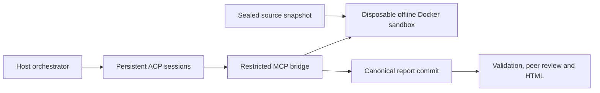

# How the source security review works

The normal `audit run` workflow is `source_security_review_v1`: an authorized review of supplied source, configuration, dependency metadata and tests already present in that source. It produces evidence-backed findings and remediation guidance. It excludes exploit/PoC generation, arbitrary commands, new test programs, deployed-service probes and transaction construction.

## Source and sandbox

The parent captures a sealed source manifest and an inventory of existing test entry points. Secrets, authentication stores, dependencies and build outputs are omitted from the snapshot. The report records omissions rather than claiming complete coverage.

`sandbox.sh --review-only` creates one disposable container as uid 10001, with capabilities dropped and privilege escalation disabled. Trusted static scanners and the lead harness inspect source and dependency metadata. Preparation does not run target builds, target install scripts, lifecycle hooks, target tests or active service scans. A trusted manifest-only preparer may fetch locked crates.io dependencies into the container cache without executing target code; target Cargo configuration, custom registries and Git dependencies are refused. After the static scanners, each `package-lock.json` project gets `npm ci --ignore-scripts`, which fetches lockfile-pinned packages without running install scripts (an out-of-sync lockfile falls back to `--legacy-peer-deps`, then `npm install --no-save`; the mode is recorded), so offline npm and cross-language suites find `node_modules`. The image carries PostgreSQL 16 and Redis server binaries for suites that start disposable servers on Unix sockets; `/tmp` is an executable tmpfs because suites create and run temporary environments there. Scanner availability and failures remain explicit coverage limits.

Before publishing `ready.json`, the parent removes the proxy and verifies that the sandbox has no network attachment. Failed verification prevents reviewer handoff. The coordinator then attempts each frozen existing-test entry point through the restricted bridge before assigning surface reviews; reviewers may request the same fixed tests during inspection. Container preparation has a bounded budget; the subsequent held review has no elapsed-time deadline. Completion or cancellation releases the container, and cleanup removes owned resources. Docker daemon availability is necessary to verify removal.

## Stack routing

There is no chain flag. The harness writes `harness/stack-profile.json` from production manifests and production source. The profile records Python, Node/TypeScript, Rust, Solana, and NEAR. One repository can match several. Tests, docs, scripts, and fixtures do not decide the stack. Absent ecosystems receive no checks.

A Solana program is an `Anchor.toml`, or a `Cargo.toml` dependency on `anchor-lang`, `solana-program`, `solana-sdk`, or `pinocchio`. Reviewers get `solana.md`. The run compiles matching cdylib crates offline with image platform-tools into `/work/target/deploy/*.so`, then `cargo test --locked --offline`. The operator may pass `--test-artifacts`. There is no RPC and no transactions. On-chain program release verification is a separate operator gate.

A NEAR contract is a production `Cargo.toml` line `near-sdk = …`. Reviewers get `near.md` and read source against the NEAR security checklist (https://docs.near.org/smart-contracts/security/checklist). They must not fetch that page from the sandbox. `cargo test` is not catalogued for that package or a workspace that contains it, because it can start near-sandbox or deploy to testnet. The report records that coverage gap. near-sdk crates are not compiled as Solana SBF programs. NEAR clients (`near-api-js` or `@hot-labs/near-connect`) are client leads, and that package's npm test stays catalogued. NEAR Intents (`@defuse-protocol/one-click-sdk-typescript`, `@defuse-protocol/intents-sdk`, `@near-intents-agent-api/sdk`) are leads only; that package's npm test is not catalogued, and hosted quote, deposit, and agent APIs stay uncalled. NEAR AI (`@neardefi/shade-agent-js`, `near-ai-cloud`, or `cloud-api.near.ai`) is a recognition lead. Shade Agent is an unaudited library. The run does not call NEAR AI Cloud, OutLayer, or NEAR MCP. A production string such as `v1.signer` is a lead in `near.md`. It does not by itself mark the repo as NEAR, and the run does not read mainnet. The run does not call NEAR RPC, the faucet, or a chain-signature signer.

The image does not contain `cargo-near` or the wasm32 target. Do not install them. `cargo near check --clippy` and `cargo near build non-reproducible-wasm` are documented offline commands that this image does not run. That absence is a coverage gap. Do not run `cargo near build reproducible-wasm`.

Python pytest runs offline after a wheel-only environment, and Node runs `npm --offline --ignore-scripts run test`.

## Sessions and tool boundary

Claude and Codex use lockfile-pinned ACP adapters in `runtime/`; Grok uses native ACP with isolated MCP-only configuration; AGY uses a compatibility adapter around its saved native conversation. Official host CLIs remain trusted host processes using their normal authentication. Host filesystem, shell, app and web tools are disabled or denied by the respective profile, permission handler and AGY hook. No credentials are copied into the sandbox.

Every assignment binds its workflow, source digest, model, role and assignment digest. The parent saves session state and records a heartbeat every 30 seconds without imposing a reasoning deadline. One unexpected transport loss may reload the exact session when supported. Provider policy refusals, quota failures and authentication failures do not trigger automatic retries or model changes.

Providers run concurrently, each with one active assignment and a queue of its remaining surfaces. A faster provider advances its own queue without waiting for peers. All surface reviews settle before peer cross-checks start together; all active sessions settle before sandbox cleanup, including after cancellation or failure.

`--resume-from` requires matching workflow, source, models, reviewers and assignments before starting Docker. Older adversarial sessions and the old AGY finalization path are rejected. Preserve saved session directories when resuming. Successful immutable submissions are reused without another provider call; failed assignments retain their exact sessions. Changed peer claims require new cross-check assignments, and the new runtime collects test/scanner evidence again.

## Reviewer tools

| Tool | Purpose |
|---|---|
| `get_audit_context` | Scope, assignment and scanner coverage |
| `get_review_plan` | Source inspection checklist and cited leads |
| `list_files`, `read_file`, `search_code` | Bounded source and report inspection |
| `list_existing_tests` | Source-bound test IDs and descriptions |
| `run_existing_tests` | Run one fixed test entry point by ID |
| `submit_audit_report` | Commit a validated surface report |
| `submit_crosscheck_report` | Commit a verdict for every assigned peer claim |

The bridge rejects removed execution/PoC tools even if a caller invokes them directly. `run_existing_tests` accepts only `test_id`; callers cannot supply commands, arguments, code, paths or environment settings. Each invocation verifies network disconnection and the captured entry-point manifest hash. Reviewers receive the coordinator's hash-checked pre-review run of a suite instead of a rerun, so long suites do not outlive a CLI's MCP call deadline or hold the shared test lock.

Supported fixed entry points are `npm --offline --ignore-scripts run test`, `cargo test --locked --offline`, `python -m pytest -p no:cacheprovider -q --tb=line` (wheel-only dependencies from pypi.org on the declared Python version, installed by a trusted step before the network is detached; tests needing a database or other service report a coverage gap), and `bash --noprofile --norc ./test.sh`. The npm test itself runs; npm pre/post hooks are suppressed. Existing tests are still untrusted target code and run only inside Docker. Each invocation has a fixed process-group limit: 15 minutes for npm, Cargo and shell suites (including cold compilation) and 30 minutes for pytest, distinct from reviewer reasoning, which has no runner deadline (the operator sets a per-pass tool budget). Dependencies must already be available; missing dependencies and unsuccessful tests are coverage gaps. Tests are not rewritten or installed as a workaround.

An atomic directory lock under the report's harness serializes test execution across MCP bridge processes sharing that sandbox. Source inspection and reasoning remain parallel. The bridge waits up to five minutes to acquire the lock, then verifies offline containment and starts the bounded test. Normal completion or failure releases the lock. A bridge crash leaves the lock in place rather than allowing a possibly running Docker test to overlap; recovery requires a new review or resume into a new output directory and sandbox.

## Evidence and completeness

New findings require source `analysis`, `validation` (including limits), citations, impact and a fix. Control assertions require `evidence`. Historical report compatibility stores empty `attack`/`poc` fields and mirrors control evidence into the legacy field. This does not enable those activities.

A validated `submissions/<job>.json` MCP commit is authoritative. Derived JSON, Markdown and HTML must match it. Identical repeated submissions are idempotent; conflicting commits fail. Terminal prose is never treated as a report. `report_json` supports providers with unreliable nested argument serialization.

Peer reviewers inspect the same snapshot and return complete claim-level verdicts. Validation checks submissions, actual process exits and required peer coverage before adjudication. Missing/failed/invalid output stays `INCOMPLETE`, including a process that submits and later exits unsuccessfully. Zero findings alone is not a clean audit. Scores express model agreement and review status, not independent proof.

Output validation, executed coverage and security acceptance are separate. Source-bound existing-test results and structured scanner outputs feed the coverage check. Missing or altered output and unavailable scanners leave coverage incomplete. A suite is verified only when a successful run reports at least one passing test and no failed or skipped tests. The scanner set is Gitleaks, Semgrep, OSV Scanner, cargo-audit and npm audit; applicability depends on captured source and lockfiles. Scanner findings remain findings, not scanner execution failures. Test counts and scanner results are tool-reported evidence, not authenticated vulnerability reproduction. Passing checks do not accept residual risks or certify security.

`check-agents --live` uses a separate inert fixture to qualify MCP access, saved-session recovery and submission. It is transport evidence, not security coverage or provider-policy clearance. The selected-file relay and historical standalone utilities are separate from this workflow; see [the suite guide](../README.md) and [live-model integration](live-model.md).

## Report and documentation presentation

The [operator guide](index.html) and generated reports share `scripts/report-style.css`: white panels, orange accents, black navigation, angular geometry, and red/blue/green status colors. The guide adds documentation layouts in `docs/style.css`; keep the common visual tokens in the shared stylesheet. All styles load locally, without external fonts or network dependencies.

`./bin/audit html <report-dir>` regenerates `report.html` and `findings-by-model.html` from saved evidence without starting model sessions. The generator embeds the shared CSS and `report-browser.js` into standalone pages. It validates the current saved inputs before rendering; an incomplete review still renders and exits with status 2.

The overview shows severity totals and per-surface output coverage. A missing assignment is explicitly incomplete even when its finding count is zero. Collapsed finding rows expose short impact previews; expanding a row reveals impact and remediation, followed by separate disclosures for full source analysis, affected files and peer evidence. Original accepted claims supply the analysis omitted from scored-cluster summaries. Severity and surface filters combine with full-text search; low severity includes informational claims. Keyboard-accessible native details work offline, and printing expands the evidence while preserving the reader's previous disclosure state afterward.

Claims are merged into one finding by shared root cause (`scripts/cluster-findings.mjs`): two claims from different auditors merge when they cite at least two of the same files within three lines of each other, regardless of surface or wording; an identical title with a shared citation also merges. A single shared file never merges claims, and one auditor's claims are never merged with each other. A merged finding leads with its highest-severity claim, keeps every claim id, and shows the severity spread. Cross-auditor pairs that overlap on one file but stay separate are listed under `dedup.candidates` in `report-health.json`, and titles that bundle several defects are listed under `dedup.compoundClaims`; both are advisory and never change the review state.

The model page counts each model's original findings before deduplication and groups critical with high. It displays received/expected outputs beside each requested model. Counts measure output, not reviewer quality. Reported control assertions and model agreement remain unverified; green never means certified safe. Attached SVG is escaped as inert source, all reviewer/source text is escaped, and report scripts use a nonce CSP.

## Reviewers, presets and phases

A **reviewer** is one model in one family, written `<family>:<provider>:<model>[#label]` (`cli:claude:opus`, later `key:zai:glm-5.3`, `openrouter:qwen/qwen3.8-max-0902`). Its id is a slug of the spec (`cli-claude-opus`; `/ . :` become `-`) or the label, and it names its jobs (`cli-claude-opus-s2-input`) and files. Its vendor is derived (`anthropic`, `openai`, `xai`, `google`, `zai`, `alibaba`); peer cross-checks exclude reviewers of the author's own vendor. Only the `cli` family exists in this wave; `key`, `openrouter` and `scripted` specs parse, and `--plan` and `run` exit 2 with the wave that adds them.

`./bin/audit run` takes `--reviewers a,b`, `--config file`, `--preset name`, `--assign matrix|round-robin`, `--orchestrator <spec|recommended>`, `--alternate-judge <spec>`, `--passes N` and `--tool-budget N`. `--agents`, `--model`, `--models` and `--model-<agent>` remain as aliases for `cli:` reviewers and keep today's one-reviewer-per-surface split. Precedence: flags, then the preset, then `omniswarm.config.json` (copy of `omniswarm.config.example.json`, read from the OmniSwarm checkout or `--config`, never from the target), then defaults (2 passes, 40 tool calls per pass, 2 debate rounds). The orchestrator, judge, passes and budgets are recorded in `harness/reviewers.json` and `meta.json` but not yet enforced; `--plan` prints the reviewer table, the reviewer by surface matrix and the recommended orchestrator.

The orchestrator runs a phase list: `prepare, tests, review, crosscheck, debate, adjudicate, general-review, report`. `debate`, `adjudicate` and `general-review` are no-op stubs; a later wave replaces one, or adds a phase after a named one, by adding `scripts/orchestrator-phase-<name>.mjs`. Until teardown `meta.json` keeps `finalized:false`, so a crash leaves a report that validation reports as incomplete. Report files are written atomically (temp file, then rename).
