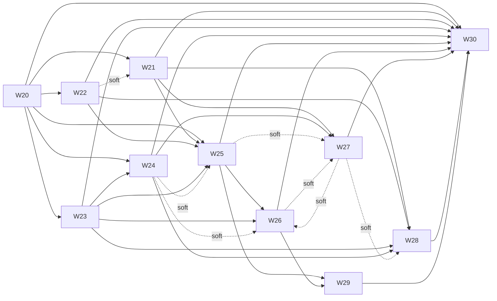

# Debate and orchestrator v2: plan for waves W20–W30

> **Status:** 2026-11-11, revised after three review iterations (§11). Plan only. Nothing below is built. It opens after the 2026-11-14 submission (calendar rule, §8); nothing in it enters the final sprint.
> **Inputs:** [`DEBATE_V2_EVIDENCE.md`](./DEBATE_V2_EVIDENCE.md) (two live runs and the literature, with how well each source was checked), [`PRODUCT_WAVES.md`](./PRODUCT_WAVES.md) (the wave method), [`FINAL_SPRINT.md`](./FINAL_SPRINT.md) §5 (issue DoR and DoD), [`../spec/ORCHESTRATION.md`](../spec/ORCHESTRATION.md) §4 (the debate protocol being replaced behind a flag), [`../RULES.md`](../RULES.md).
> **Wave files:** [`waves/W20-spine.md`](./waves/W20-spine.md) … [`waves/W30-proof-campaign.md`](./waves/W30-proof-campaign.md).
> **Names used in this plan:** `M1`–`M19` measured facts; `E1`–`E38` literature; `D1`–`D8` design principles (§3); `T1`–`T9` thresholds, `G0`–`G4` gates and `A0`–`A3` arms (§6); `P1`–`P5` proof tiers (§7); `L0`–`L4` ladder levels and depth 0–4 (W25, W26); `OD-18`–`OD-25` owner decisions (§10); `O1`–`O8` owner-lane steps (§9).

## 1. Why

Two live reviews of `fullstack-dapp` (three CLI reviewers, surface S3) show what the stages after the review do today (`DEBATE_V2_EVIDENCE.md` §2):

- **They never lowered a status.** 498 cross-check verdicts, none refuting a finding (`M1`). 21 challenge turns, none refuting (`M2`: 19 upheld, 2 partial). 17 devil's-advocate turns, none refuting (`M3`). No finding ended REFUTED or DISPUTED (`M6`). Every reported decoy stayed open (`M12`).
- **They are slow and mostly skipped.** In run 2 these stages took 36 of 67 minutes, 54% of the wall time (`M7`), and a large share of the tokens (an upper estimate, `M10`). Only 13 of 24 queued clusters were debated (`M5`), one turn at a time, with the slowest provider holding the clock (`M8`, `M9`).
- **The judge mostly fails for plumbing reasons.** 6 verdicts in 11 attempts. A refused submit was never nudged, because a failed tool-call frame is not matched to its submit; Codex used the wrong field names; the brief says "call once" (`M4`, `M16`).
- **Agreement is trusted too much.** Two vendors reporting the same site confirms it with no look (39 of 63 clusters in run 2), and models make correlated mistakes (`E11`).

The literature points the same way. Most of what debate adds comes from independent first answers; the exchange adds little unless something external makes updates asymmetric (`E1`, `E2`, `E3`); a verifier that does not see the author's reasoning does better (`E14`); one or two rounds are enough (`E7`, `E17`: one; `E9`: two); budgets the agent can see beat bigger budgets (`E24`); retries need a budget and a class (`E25`). **No study tests a blind verifier against debate on code with frontier cross-vendor models.** This plan builds it behind a flag and measures it (§6).

## 2. Scope and non-goals

In scope: the orchestrator's scheduling, failure handling, budget and resume; the judge's plumbing; a verification ladder behind `--verify ladder`; a model pool and presets; discovery lenses; the progress and report surfaces; and the evaluation that decides.

Not in scope, and enforced:

- **No execution, no exploit, no PoC.** The audit boundary does not move (`AGENTS.md`). Level 0 reads source and builds context; it spawns no process (W25-02 runs its tests under Node's permission model). Evidence from systems that validate by running an exploit (`E22`) motivates mechanical gates here, not executable ones.
- **No new network path** in `engine/scripts/`, no widening of a reviewer's tools or permissions, no `--rpc`. The hosted preset's effective configuration and the intake argv are tested unchanged (W27-06).
- **No key in the bridge or the sandbox.** A pool member follows the key policy (W27-03).
- **The legacy path stays** (`--verify debate`) until gate G4, and is not removed in this series.
- **The host path is not covered.** `--no-docker` runs and `./bin/audit demo` without Docker call `runReviewSession` directly and bypass the execute seam. The series' features are Docker-path features, `--plan` says so, and neutrality tests drive `runOrchestratedAudit` with an injected scripted `review`.
- **Nothing enters the final sprint.** D13 is a freeze for doc and test fixes.

## 3. Design principles

Each is cited by the issues that rest on it. A principle is only as strong as its evidence tag; the tags are in the evidence file.

| ID | Principle | Evidence |
|---|---|---|
| **D1** | **Measure before you change, and fix thresholds before you look.** A baseline of repeated runs sets every pass or fail line, signed and tagged at G1. A fixture on which a stage that removes nothing scores the same as one that works cannot judge that stage. | `M12`, `M14`, `E35` |
| **D2** | **Independent, blind verdicts first; interaction only where verdicts disagree and something external can settle it.** One exchange at most. | `E1`–`E3`, `E6`, `E7`, `E9`, `E14`, `E17` |
| **D3** | **Mechanical gates before model judgement.** Citations exist and are relevant; a counted refutation needs a verified, anchored control; the rules fix which statuses a judge may return. | `E6`, `E17`, `E18`, `E22`, `E36` |
| **D4** | **Diversity with a quality floor.** Different vendors check each other; a weak or unreliable member does not get an equal vote; agreement is a prior, not a verdict; a check that shares an author's vendor is flagged. | `E5`, `E8`–`E11`, `E19` |
| **D5** | **Budgets are first-class and results are anytime.** Agents see what is left; every cluster holds a valid status from the start; running out of budget ends in a report, not a crash. | `E23`, `E24`, `E31` |
| **D6** | **Failures have classes, and the class decides the action; there is one retry layer per kind of failure.** Transport errors use the session's own recovery, rate limits wait inside the deadline, a usage limit is not retried, a timeout is not repeated on the same provider, and invalid output is retried once by the layer that owns the role (W22-06 debate and judge, W28-05 auditors). One retry budget counts every attempt. | `E4`, `E25`–`E30` |
| **D7** | **Every feature is reversible and neutral by default:** a flag, a bypass switch, a default equal to today, and a test that shows it. The legacy path stays until the proof. Plumbing fixes (W22) are the exception: they change defaults on purpose, each is covered by a test and listed in the check guide. | — |
| **D8** | **The audit boundary does not move.** Read-only source tools, host-only telemetry that never steers a decision, structured frames and never log text, nothing from the target in an instruction channel except inside a fenced untrusted block. | `AGENTS.md` |

## 4. Waves

| Wave | Name | Track | The demo (what the owner sees at the check) | Depends on (hard) | Soft | Issues (units) |
|---|---|---|---|---|---|---|
| [**W20**](./waves/W20-spine.md) | Spine: execute seam, telemetry, gates | E + Lead | `events.jsonl` from a scripted orchestrated run; reserved flags in `--plan` and refused on a real run; coverage gate, plan linter and wave-check runner wired into CI | — | — | 13 (11) |
| [**W21**](./waves/W21-measure.md) | Measure: scorecard, replay bundles, fixed twin, baseline protocol | E (eval) + Lead | `npm run eval:replay` reproduces the evidence table offline; a fixed twin; baseline aggregator and the pre-registration | W20 | W22 | 11 (9) |
| [**W22**](./waves/W22-judge-reliability.md) | Submit contract and judge reliability | E + Lead | A failed submit is noticed and nudged; the recorded refused submit shapes are accepted; 9 of run 2's 13 debated clusters need no judge; a judge chain | W20 | — | 12 (9) |
| [**W23**](./waves/W23-scheduler.md) | Scheduler and provider health | E + Lead | A chaos table: lanes at half the serial wall time; a parked provider; one retry budget; straggler cut; failover and hedge helpers | W20 | — | 12 (10) |
| [**W24**](./waves/W24-budget.md) | Budget, anytime results and resume | E + Lead | A 2-minute envelope still ends in a report; ledger; kill and resume to the same result; pause on a quota reset | W20, W23 | — | 10 (8) |
| [**W25**](./waves/W25-ladder-1.md) | Verification ladder I: evidence gate, blind verifier | E + Lead | `--verify ladder`: every cluster verified blind by an independent tier; agreement is a prior; legacy output unchanged | W20, W21, W22, W23 | W24 | 15 (13) |
| [**W26**](./waves/W26-ladder-2.md) | Verification ladder II: refuter, one exchange, judge panel | E + Lead | Anchored refutations only; one exchange; a panel with a down seat still rules; refuted findings kept in an appendix | W25, W23 | W24, W27 | 13 (11.5) |
| [**W27**](./waves/W27-roles-pool.md) | Roles, pool and presets | E + Lead + B (one test) | Role cards; a priced pool judge that is never a discovery reviewer; effort per role; `quick`, `standard`, `deep` in `--plan` | W21, W24 | W25, W26 | 10 (7.5) |
| [**W28**](./waves/W28-discovery.md) | Discovery lenses and extra attempts | E + Lead | `--lenses auto` per-reviewer lens passes; budget-gated resampling; retry with new information | W21, W22, W23, W24 | W27 | 9 (7) |
| [**W29**](./waves/W29-surfaces.md) | Report and live progress surfaces | E + B + F + Lead | Terminal row, API detail and web panel show depth, budget and a parked provider; report depth badges and an appendix | W25, W26 | W23, W24, W27 | 9 (7) |
| [**W30**](./waves/W30-proof-campaign.md) | Proof campaign and decision | Lead + E + owner | A pre-registered, interleaved campaign on three targets; exact paired tests; the presets flip only for an arm that passes | W20–W29 | — | 11 (8.5) |

Totals (from the wave files, computed by the plan linter): **125 issues, 101.5 units**. The critical chain is **W20 → W21 → W25 → W26 → W29 → W30, 30 units** of chained issues.

Second landings (`wave-NN.2`, the `wave-17.2` precedent) carry the pieces that need a wave the first landing does not depend on: W25-13 (budget scenario, after W24), W26-11 (budget scenario, after W24), W27-09 (pool into the debate plan, after W26).

**What can run in parallel** (the linter checks owned-path overlap between every pair of waves with no dependency path; §6.2 lists the declared exceptions):

| Slot | Waves open | Why they do not collide |
|---|---|---|
| A | W20 | Six issues at once on disjoint paths; every later wave needs its seam, registries and gates |
| B | W21 ‖ W22 ‖ W23 | W21 owns `engine/eval/**`; W22 the bridge submit tools, briefs, the judge and the submitted-tracking; W23 the scheduler files and `audit-process.mjs`. Lanes, retries and budgets are execute middleware, one file each |
| C | W24 (after W23) ‖ W25 (after G1) | W24 owns budget files, `orchestrator-phases.mjs` and the bridge's tool-result builder; W25 owns `debate-*` and the verifier role |
| D | W27 ‖ W28 (W25 finishing) | W27 owns the pool, presets and providers; W28 the pass loop and lenses |
| E | W26 (W27 and W28 may finish) | W26 follows W25 in `debate-run.mjs` |
| F | W29 | Surfaces follow the contract W26 settles |
| G | W30 | Closes the series |

At most 4 waves are open at once. The repository rule is at most 6 issue agents at once plus the lead (`FINAL_SPRINT.md` §6); critical-chain waves (W21, W25, W26, W29) get agents first.

## 5. Reserved flags and config keys

W20-06 adds these to `bin/audit`, the closed allow-list in `orchestrate.sh`, `run-config.mjs` and the request `orchestrate.sh` builds, once, so no later wave edits any of them. Until its wave lands each flag is accepted, validated and carried, `--plan` prints it as **reserved**, and **a real run that passes it is refused naming the wave**: a safety flag such as `--max-minutes` is never silently ignored. **A run that passes none of them behaves as today.**

| Flag | Config key | Default (= today) | Filled by |
|---|---|---|---|
| `--lane-width <n or vendor=n,…>` | `scheduler.laneWidth` | 1 | W23 |
| `--retry-attempts <n>` | `scheduler.retryAttempts` | today's one transport recovery | W23 |
| `--hedge` | `scheduler.hedge` | off | W23 |
| `--straggler-grace <seconds or off>` | `scheduler.stragglerGraceSec` | off | W23 |
| `--max-minutes <n>`, `--max-tokens <n>` | `envelope.maxMinutes`, `envelope.maxTokens` (the object is `envelope` because `budgets` already exists) | unset | W24 |
| `--max-cost-usd <n>` (exists) | `maxCostUsd` (the existing top-level key) | unset | W24 |
| `--verify <debate or ladder>` | `verify.mode` | `debate` | W25 |
| `--verify-min-severity <level>` | `verify.minSeverity` | `info` (all clusters) | W25 |
| `--verifiers <n>` | `verify.verifiers` | 2 | W25 |
| `--canaries <file>` | `verify.canaries` | none (an evaluation instrument) | W25 |
| `--refute <auto or off>` | `verify.refute` | `auto`: a refuter runs on escalated clusters (a split at level 1, a `partial` on a high or critical finding, a single verifier on a high or critical finding); a critical finding needs two anchored refutations; `off` sends escalated clusters straight to the panel | W26 |
| `--panel <n>` | `verify.panel` | 3 | W26 |
| `--pool <spec,…>`, `--pool-cost-usd <n>` | `verify.pool`, `verify.poolCostUsd` | none; `--pool` needs the ceiling | W27 |
| `--lenses <auto, off or ids>` | `discovery.lenses` | off | W28 |
| `--extra-attempts <n>` | `discovery.extraAttempts` | 0 | W28 |

**Presets** (config, W27-05; the values are proposals, set at G1 from the baseline, OD-21 and OD-22):

| | `quick` | `standard` | `deep` |
|---|---|---|---|
| passes | 1 | 2 (pass 2 a lens when W28 has landed) | 3 |
| `--verify` | ladder, `--verify-min-severity high`, 1 verifier | ladder, all clusters, 2 verifiers | ladder, all clusters, 3 verifiers |
| `--refute` | off | auto | auto |
| `--panel` | 1 | 3 | 3 |
| lane width | 2 | 2 | 2 |
| `--straggler-grace` | 180 | 300 | off |
| budget | 20 min | 45 min | 120 min |
| aim | about 15 min | about 45 min | 2 hours or more |

The presets ship at W27 with `verify.mode: debate`; the ladder values in the table (verifiers, refute, panel, minimum severity) are present and inactive. `verify.mode: ladder` is set only at G4 and only for a preset whose arm passes (`standard` for A2, `deep` for A3); `quick` is not an arm and stays on `debate` unless the owner adds one. The `hosted` preset is **not** changed by this series (W27-06 pins its resolved configuration), and the bare default of `--verify` stays `debate`.

## 6. Gates, thresholds and shared files

### 6.1 Arms, gates, thresholds, statistics

**Arms**

| Arm | Settings | Used for |
|---|---|---|
| **A0** | `--verify debate`, lane width 1, at the W22 state | the baseline and every comparison |
| **A1** | `--verify ladder` at the W25 state (ladder I; the contested path is still the legacy one). Every flag it needs exists at G2 | G2 |
| **A2** | `--verify ladder` at the W26 state with default flags (ladder I and II, lane width 1, no envelope). At G4 it runs through the `standard` preset (lane width 2, 45-minute envelope) | G3, G4 |
| **A3** | the `deep` preset | G4, optional |

**Gates**

| Gate | When | Passes when | Who |
|---|---|---|---|
| **G0** | Before W20 opens | The owner has read this plan. No decision is needed to **open** W20–W24. W21 needs OD-25 to land its replay proofs in CI (without it they run on the owner's host only), and every live spike and run needs OD-22 | owner |
| **G1** | After W21 and W22, before W25 | The baseline (O1) is in `DEBATE_V2_BASELINE.md`; `DEBATE_V2_PREREG.md` (arms, targets, repeats, analysis rule, thresholds T1–T9) is **signed**: the owner commits it, tags the commit `prereg-v2` and records its hash in the §10 decision log; OD-18, OD-19 and OD-22 are recorded. Thresholds are never changed after this tag | owner |
| **G2** | After W25's live proof (O2) | A1 against A0: the primary thresholds T1, T2, T4 pass on the fixed twin and on `fullstack-dapp` S3 and the guards T5–T8 hold. A miss on a primary closes W26 | owner |
| **G3** | After W26's live proof (O3) | A2 against A0: the same criteria, plus `true_bug_refuted_after_gate` at most the T2 cap. A1 is reported beside it | owner |
| **G4** | Inside W30 (O4) | A2 (and A3 if run) against A0 on the fixed twin, `fullstack-dapp` S3 and the held-out fixture: primary T1, T2, T4 pass on **every** main target and T5–T8 hold. Each passing arm sets `verify.mode: ladder` in its preset; a failing arm changes nothing | owner |

**Thresholds.** The values are **proposals** until G1, when the owner fixes them once, after seeing the baseline's variance and before any ladder run is scored. Each is "the ladder arm against A0, paired by target and repeat". Metrics are defined for both arms in W21.

| ID | Metric | Proposed line |
|---|---|---|
| **T1** | `fp_catch_rate` (claims matching a decoy or a repaired site in the key that end REFUTED or DISPUTED, or end not CONFIRMED where the legacy rules would have confirmed them from the same recorded turns, over such claims reported; measured on natural false positives in every arm; a pair in which either arm reported none is excluded, and a target with fewer than 3 usable pairs makes T1 `inconclusive` there, so G2 does not pass on it) | at least A0 + max(2 sd, 0.25) |
| **T2** | `true_bug_refute_rate` (seeded bugs reported that end REFUTED or DISPUTED; narrowing to LIKELY is shown by `bug_loss` and the transition matrix, not counted here) | at most A0 + max(2 sd, 0.02), and never above 0.05 |
| **T3** | `decoy_survival` (secondary, reported) | at most A0 − max(2 sd, 0.15) |
| **T4** | `bug_loss` at the end | at most A0 + max(2 sd, 1 bug) |
| **T5** | wall minutes | at most 1.25 × A0 |
| **T6** | canonical tokens per kept finding (compared within one panel only) | at most 1.5 × A0 |
| **T7** | `depth_coverage` (clusters at depth 1 or more; legacy depth is 1 when a non-author vendor gave a counted verdict), no provider outage | at least 0.9 |
| **T8** | tasks refused or unanswered | at most 5% of tasks |
| **T9** | noise guard: if the baseline sd of T1 exceeds 0.15, the repeats for T1 rise from 3 to 5 | a rule, not a metric |

Injected canaries are reported separately (`canary_catch_rate`); they compare ladder variants with each other and are **not** T1, because the legacy arm has no injection point.

**Statistics.** The baseline uses 3 repeats per target: its standard deviations come from 2 degrees of freedom and are **indicative**; the floors in the thresholds exist for that reason. G2 and G3 use 3 repeats per arm and target and the rule "every pair clears the line on every main target". The G4 campaign uses 5 repeats on the fixed twin and on `fullstack-dapp` and 3 on the held-out fixture, reports the exact paired sign-flip permutation p-value beside the unanimity verdict (the smallest attainable two-sided p is 1/16 with 5 pairs, so the p-value is descriptive and the decision is unanimity), and claims no interval from fewer than 5 pairs. T1, T2 and T4 are the primary decisions; T3 and T5–T8 are guards or reported. The held-out fixture (W30-04, W30-05) is never used before the campaign. Choices the W25 and W26 spikes made on the run 2 bundle and the fixed twin are listed in the pre-registration, so they are visible and not a hidden degree of freedom.

**Baseline protocol (W21-08, run at O1).** One commit, one panel, N = 3 repeats on `fullstack-dapp` S3 and 3 on the fixed twin, taken after W22 so plumbing failures do not hide the behaviour being measured. Mean, sd, min and max per metric; fewer than 3 repeats is refused. A run with a provider outage is rerun once and both are kept.

### 6.2 Shared files and hand-offs

The wave linter (W20-08) checks that no two waves that can be open together own one path. These are the declared exceptions and the sequences that make the rest safe.

| File or area | Owners, in order | Rule |
|---|---|---|
| `packages/schemas/**`, root `package.json`, `AGENTS.md`, `.github/workflows/ci.yml` | the lead, in each wave's `-01` (and a second landing's contract step) | One `-01` lands at a time, in wave-open order. A wave never edits them otherwise |
| `tools/wave-checks.json` | each wave's check issue edits its own key | Disjoint keys; merge `main` first |
| `docs/RULES.md`, `docs/how-it-works.md`, `docs/spec/**` | W20–W24, W27–W29 (append-only); W25, W26, W30 (rules and spec edits in turn) | Append in a wave's last doc issue after merging `main`. OD rows in `DECISIONS.md` are flipped only by copying a quoted owner statement and its date |
| `engine/scripts/agent-session.mjs` | W20 → W22 | Sequential: W20 owns token-usage accumulation, `maxRecoveries` and `ROLE_TOOLS`; W22 then owns `submitNowText`, the submitted-tracking in `onSessionUpdate` and its lazy per-turn set |
| Registries a new reason, role, tool or session name touches: `audit-process.mjs` (`FAILURE_MESSAGES`), `audit-submission.mjs` (`ROLE_NAME`, with an attempt suffix for every debate and judge name), `review-workflow.mjs` (`REVIEW_TOOLS`; the tool policy derives from it), `bridge-budget.mjs` (unbudgeted roles), `docker-mcp-bridge.mjs` (the reviewers-file role gate), `orchestrator-session.mjs` (budget branch, the `run.review` call), `debate-test-run.mjs` (submit table), `provider-api-launch.mjs`, `api-acp-agent.mjs`, `provider-openai-compat.mjs` (submit tool by role) | W20 reserves every entry the series needs, inert (W20-11, W20-12); the later waves that add a role file also update `bridge-tools-registry.test.mjs` (W25, W26) | Nobody else edits a registry line. `audit-process.mjs` then belongs to W23 (`classOf`) and `bridge-budget.mjs` to W24 |
| `bin/audit`, `orchestrate.sh`, `run-config.mjs`, `reviewer-plan.mjs` | W20 (all reserved flags, a generic plan printer) → W27 (pool and preset validation in `run-config.mjs`) | Waves add `reviewer-plan-feature-*.mjs` files for their `--plan` lines instead of editing the printer |
| `engine/scripts/docker-agent-orchestrator.mjs` | W20 (execute construction, crosscheck import) → W27 (judge list lines) | Sequential. Lanes, retries, budgets and resume are middleware files, not edits |
| `engine/scripts/orchestrator-review.mjs`, `orchestrator-crosscheck.mjs` | W20-05 splits → W23 (review) → W28 (review); W25 (cross-check) | Sequential by dependency |
| `debate-run.mjs`, `debate-adjudicate.mjs`, `debate-summary.mjs`, `debate-judge.mjs` | W22 (splits, judge) → W25 → W26 | Sequential by dependency |
| `debate-plan.mjs`, `debate-phases.test.mjs` | W22 (`summaryVoiceFor`) → W25 → W27-09 (the `plan.pool` field, second landing after `wave-26`) | Declared overlap with W27; sequential by landing order |
| `debate-cluster.mjs`, `debate-rules.mjs` | W25 | One owner |
| `debate-rounds.mjs` | none | The legacy contested path is not edited in this series |
| `orchestrator-briefs.mjs` | W22 only | The budget block is added by middleware; verifier and refuter briefs are new files |
| `orchestrator-phases.mjs`, `bridge-budget.mjs`, `docker-mcp-bridge.mjs`, `orchestrator-resume.mjs` | W24 only (W20 reserves the unbudgeted-role line) | One owner |
| `orchestrator-progress.mjs`, `report-section-*`, `generate-html-report*` | W29 (`incompleteLabelOf` in `generate-html-report-evidence.mjs`: W26 first) | W29 depends on W26 |
| `verify-and-adjudicate.mjs`, `verify-and-adjudicate-debate.mjs`, `report-contract.mjs` | W25 (ladder block, validator) → W26 (labels, appendix) | Sequential |
| `engine/eval/**` | W21 → W27 (`rolecards*`) → W30 (`campaign*`, `compare*`, held-out fixture, `live.mjs --fixture`); each wave adds its metrics, policies and spikes as files in `scorecard-metrics/`, `policies/`, `spikes/` | Metric modules for events of waves that do not depend on W21 are defined by W21 and return `null` until the events exist |
| Both skill copies | none | Unchanged by this series; tests in W22, W25, W26 and W28 assert it |

## 7. Method: what this series adds to the wave method

Everything in [`PRODUCT_WAVES.md`](./PRODUCT_WAVES.md) §1, §4, §5, §7 and [`FINAL_SPRINT.md`](./FINAL_SPRINT.md) §5 applies. The additions:

### 7.1 Issue DoR and DoD

**DoR, in addition to the five conditions of `FINAL_SPRINT.md` §5:**
6. The acceptance names its **positive and its negative case**.
7. Any schema, event kind, registry entry or root script it needs landed in the wave's `-01` or in W20.
8. A module's `.test.mjs` is owned with the module and sits beside it. A test file the plan names that does not exist yet is created by its issue.
9. A live acceptance or spike has an offline mode (`--dry-run` or a fixture) that runs on a developer host; the owner-gated live result goes into the wave's check guide or its Spike answers, after OD-22.

**DoD, in addition to the six conditions of `FINAL_SPRINT.md` §5:**
7. The coverage gate is green on every touched module (§7.3).
8. A test shows the default is unchanged (neutrality, tier P4).
9. The events the issue emits are covered by a scorecard or event test.
10. P1–P4 results are in the merge commit body; a P5 the issue owes is listed in the wave's check guide with its owner step.

### 7.2 Wave file sections

Every wave file from W20 on has, in this order: header (first 15 lines, so `tools/wave.mjs` parses it), Goal, Demo story, Slice, **Wave DoR**, Features covered, Issues (with an **Owned paths** column and **Parallel groups**), **Test plan**, **Analytics**, **Proof**, **Risks and rollback**, **Wave DoD**. A spike wave adds **Spike answers**. The plan linter requires them.

**Wave DoR, always:** every wave in **Depends on** is tagged; the lead's `-01` landed; any spike answered with a recorded go or no-go before the issues that depend on it; `check:wNN` reserved (W20-01) with a `tools/wave-checks.json` key; owner decisions the wave needs recorded; owned paths free; thresholds present where the wave owes a P5.

**Wave DoD, always:** `check:wNN`, `check:all` and `check:v2` green; the coverage gate green; the neutrality proof green; every new flag, env or mock switch in `docs/how-it-works.md` (append-only) and shown as active by `--plan`; both skill copies byte-identical and unchanged; `docs/RULES.md` and the spec updated where behaviour changed; no file outside owned paths changed; no key, host path or `reports/` content committed (secret sweep clean); `checks/wNN-check.md` written **from the running result**; the tag, after the owner check.

### 7.3 Test coverage contract

1. Every issue's acceptance has a positive and a negative case, named in its cell.
2. **New modules: at least 95% lines, 85% branches, 90% functions. Changed modules: not below their recorded baseline** (`DEBATE_V2_EVIDENCE.md` `M17`; engine overall 92.8 / 84.4 / 91.1, measured over the **full** engine suite, about 2.5 minutes, because a subset gives lower figures). Identical runs on one tree differ by up to 1.6 branch points, so the baseline of a module is the minimum of 3 runs and a changed module may fall at most 1.0 branch point below it. Checked by `tools/coverage-gate.mjs` (W20-07) over Node's built-in `--experimental-test-coverage`, no new dependency. The baseline may only be raised; a pure move inherits the baseline of what it moved.
3. Every new flag or config key has tests for parsing, its default, a refusal of a bad value, and its `--plan` line; a golden file shows the default is unchanged.
4. Every schema has valid and invalid fixtures; every artifact a wave writes has a schema and a test that validates it.
5. Every failure class, status and event kind has a test that produces it and one that rejects an invalid instance.
6. Property and seeded tests name their seed range and print a failing seed. A flaky test counts as a failure.
7. The boundary tests (W20-09) stay green over every engine directory: no network, wallet, GitHub or queue import, no global `fetch`, no new child-process import, no read of `harness/sandbox-run/`, classification never from log text.
8. **A wave does not land with the gate red or `check:v2` red.** CI runs `check:v2` and `test:coverage` (W20-01).

Coverage says the code ran, not that the test would catch a defect. The negative cases are the answer to that, and the live proofs the check on the models.

### 7.4 Analytics

| Layer | What | Where | Added by |
|---|---|---|---|
| Events | One `run-event` per line, kinds registered in `packages/schemas`; every string an enum or a bounded identifier | `harness/host/events.jsonl` (host-only) | W20; each wave adds its kinds in its `-01` |
| Scorecard | Stages, providers, status transitions, quality against the key, canary results, one module per metric | `scorecard.json`, a block in `live-score.md` | W21 (and metric modules from later waves) |
| Surfaces | Depth, budget, lanes, parked providers | terminal row, `progress.detail`, web panel, report badges | W29 |
| Campaign | Per-pair differences and exact tests, every metric | `DEBATE_V2_RESULTS.md` | W30 |

Rules: events and the scorecard are **display and evaluation only**. They never steer resume, restart or failure classification (AGENTS.md: structured frames, never log text). Events hold ids, enums and numbers, not source text, not log excerpts and not model-supplied strings. Every new host-only artifact lives under `harness/host/` and has a schema. No external service. Token counts use the canonical counter of W20-04; vendors count differently (`M10`), so a total is compared only within one panel. A wave does not land until its events appear in a scorecard or event test.

### 7.5 Proof tiers

| Tier | What it is | What it can show | What it cannot show |
|---|---|---|---|
| **P1** | Unit, property and coverage | A module does what its tests say | Anything about models |
| **P2** | Replay of committed bundles of real runs (W21) | A rule or policy applied to what models actually said, deterministically, no model call | How a model behaves on a new prompt |
| **P3** | Chaos: seeded fake providers on a virtual clock (W23-10) | Scheduling, retry, budget, resume, parking | Real vendor behaviour |
| **P4** | Scripted voices and neutrality: protocol and plumbing on fixtures; defaults produce today's artifacts | The pipeline is wired right and nothing else moved | Model skill: scripted answers come from the key (`engine/eval/README.md`) |
| **P5** | Live, owner lane, `OMNI_LIVE=1`, repeated, thresholds from G1, after OD-22 | Whether the models do better | Anything beyond the fixtures used |

Neutrality tests drive `runOrchestratedAudit` with an injected scripted `review` and `startSandbox`, because `./bin/audit demo` without Docker takes the host path (`review-host.mjs`), which does not pass through the execute seam. A wave lands on P1–P4 in CI. A P5 it owes is recorded in its check guide and, where it gates the next wave, at G1–G4.

### 7.6 Plan linter

W20-08 turns the checks below into `tools/wave-lint.mjs`, run by `npm run test:tools` and so by CI: header fields; dependency graph; row columns and sizes; sections; every issue in one group and every dependency in an earlier group; at most 6 per group; issue paths inside the wave's owned paths; owned-path overlap inside a group and between waves that can be open together, minus §6.2. The result of the throwaway version used to write this plan is in §11.

## 8. Calendar and agents

This is not a hackathon plan. D13 (2026-11-13) is a freeze for doc and test fixes and D14 the submission, so **nothing here opens before 2026-11-15**. If the owner wants the W22 judge fix earlier, that is a decision for the freeze (OD-23), not a default.

Elapsed time, from the 30-unit critical chain plus the owner-lane steps between gates (an estimate from the unit counts, not a commitment):

| Phase | Waves | Working days from open | Owner lane |
|---|---|---|---|
| 1 | W20 | 1–4 | G0 |
| 2 | W21 ‖ W22 ‖ W23 | 5–10 | **O1** baseline and the signed pre-registration, days 10–12; **G1** |
| 3 | W24 ‖ W25 | 11–18 | O5 spikes inside each wave; **O2**, **G2** |
| 4 | W27 ‖ W28 (W25 finishing) | 15–20 | O5 spikes |
| 5 | W26 | 21–28 | **O3**, **G3** |
| 6 | W29 | 29–32 | owner check |
| 7 | W30 | 33–38 | **O4** campaign (about 44 hours of provider time, several days), **G4** |

About **9 to 11 weeks** with at most 6 issue agents at once (the campaign alone is about 60 hours of provider time). More agents shorten the parallel waves but not the chain, which the gates and live runs bound.

Per slot, the lead lands each wave's `-01`, merges `main` into every open wave after each landing, and writes the check guide from the running result.

## 9. Owner lane

Live steps run with `OMNI_LIVE=1`, on the owner's host, only after **OD-22**, and state their cost. No live step is part of a CI check. Each owner-run acceptance has an offline `--dry-run`. Costs below are **estimates**: tokens are cumulative including cached reads from the host logs, so billed cost is lower, and the review stage is a lower bound (`M10`); a ladder run is taken at 1 to 1.5 times a legacy run's tokens.

| Step | What | Blocks | Runs | Wall time | Cumulative tokens |
|---|---|---|---|---|---|
| **O1** | Baseline: A0, 3 repeats on `fullstack-dapp` S3 and 3 on the fixed twin; then sign `DEBATE_V2_PREREG.md` and tag `prereg-v2` | G1, W25 | 6 | about 7 h | about 37 M |
| **O2** | W25 live proof: A1, 3 repeats on each of the two targets (A0 is the O1 baseline) | G2, W26 | 6 | 7–8 h | 37–55 M |
| **O3** | W26 live proof: A2, 3 repeats on each of the two targets | G3, W29, W30 | 6 | 7–8 h | 37–55 M |
| **O4** | Final campaign (W30-07): A0, A2, A3 on the fixed twin and `fullstack-dapp` S3 (5 repeats each) and the held-out fixture (3) | G4 | 39 | A0 about 14.5 h, A2 14.5–18 h, A3 up to 26 h: about 55–59 h | 290–400 M (A3 runs three passes, three verifiers and a panel: 2–2.5 times a legacy run) |
| **O5** | Small live spikes: W23-00 (concurrency and limit frames), W24-00 (cost frames), W25-00 (blind verifier arms), W26-00 (refuter relevance), W28-00 (lenses) | the wave's later groups | partial runs | a few hours | about 30–40 M |
| **O6** | Answer OD-18 to OD-25 (§10) | the waves they gate | — | — | — |
| **O7** | Quota plan: Claude's subscription limit is shared with the owner's own sessions and took out Claude's cross-check, devil turns and general review in run 1. Schedule runs off-hours | every live step | — | — | — |
| **O8** | Read and record each vendor's terms for parallel sessions before any width above 1 | W23 live proof | — | — | — |

**Total** for the series: about **430 to 590 million cumulative tokens and about 80 hours** of provider wall time (O1 7 h, O2 and O3 7–8 h each, O4 55–59 h, plus the spikes). W30-00 replaces these figures with a computed table from the baseline scorecards before OD-22 is asked for the final campaign.

## 10. Owner decisions, drop order and risks

New rows for [`../spec/DECISIONS.md`](../spec/DECISIONS.md). Only the owner flips a row; a lead copies a quoted statement and its date. OD-18 supersedes the debate parts of OD-03 and OD-14 when answered.

| ID | Question | Recommendation | Blocks | If unanswered |
|---|---|---|---|---|
| **OD-18** | Replace the cross-check, the devil's-advocate turn and rounds 2 and 3 with the verification ladder? | Build the ladder behind `--verify ladder`, keep the legacy path, and set the preset default only at G4 on a pass | W25 opens, W26 opens, W30-08 | Nothing blocks W20–W24. W25 does not open |
| **OD-19** | What makes a run INCOMPLETE, and what does a shortfall of verification show? | INCOMPLETE only for a review coverage gap or a reviewer's provider failure. A shortfall of verification is per-finding depth and, below 90% of clusters at level 1, the label `PARTIALLY CHECKED`, shown **in addition** to `INCOMPLETE VERIFICATION` (which means tests or scanners did not run) | W25 (a hard DoR item), W26-07 | **No default.** W25-10 does not start and G1 is not passed |
| **OD-20** | May a pool of API models outside the reviewer set act as verifier, refuter, judge and summary writer, and at what spend ceiling? | Up to 2 priced models, `--pool-cost-usd` required (suggest 5 per run), off by default, hosted preset unchanged | W27-03 live use | The code lands; no live use |
| **OD-21** | Allow 2 concurrent sessions per subscription CLI? | Yes, behind `--lane-width`, after the vendor terms are read (O8) and W23-00 shows the behaviour. Default stays 1 | W23 live proof, presets with width 2 | Width stays 1; chaos proofs only |
| **OD-22** | What may the live evaluation spend, and when? | The cost table of §9 (about 430 to 590 million cumulative tokens, about 80 hours), run off-hours, replaced by W30-00's computed table for O4 | O1 and every later live step, every live spike | No live step runs |
| **OD-23** | Pull the W22 judge fix into the 2026-11-13 freeze? | No. Wait for 2026-11-15 | — | Waits |
| **OD-24** | Build a held-out fixture (at least 30 seeded bugs, 10 decoys, three stacks, a different product) that the pipeline never sees before the campaign? | Yes: W30-04 and W30-05, about two agent-days each | G4 | G4 can set no preset default |
| **OD-25** | Commit field-allow-listed replay bundles derived from live runs (CLAUDE.md says not to commit `reports/`)? | Yes, as derived fixtures under `engine/eval/replays/` with a schema allow-list and a sanitiser; they hold fixture finding titles and quotes and no log text | W21-03, every P2 proof in CI | Bundles stay in an ignored folder and P2 proofs run only on the owner's host |

**Decision log** (filled at each gate):

| Date | Gate or decision | Outcome | Evidence |
|---|---|---|---|
| — | — | — | — |

**Drop order if behind:** 1) W28 lenses (keep the retry-with-information issue); 2) W27 effort dial and pool (keep role cards and presets); 3) W23-08 hedging; 4) the web panel in W29 (keep the terminal row and the report); 5) W26 (keep ladder I with the legacy contested path). **Never drop:** W20, W21, W22, the baseline, the pre-registration, the neutrality proofs, the coverage gate.

**Top risks:**

| Risk | Mitigation |
|---|---|
| The blind verifier does not beat the rubber stamp | The W25 spike gate is a kill switch with pre-registered criteria; W22–W24 deliver value without the ladder |
| A verified but irrelevant citation refutes a real bug | Tightened anchoring, plant-resistance fixtures, two refuters for critical findings, the W26 spike, the appendix (nothing deleted), T2 as a cap |
| Thresholds drift toward the result | G1 signs and tags the pre-registration; a test compares the thresholds with the tag |
| One fixture family | The held-out fixture in W30; per-target verdicts |
| Live runs cost more than planned or the quota runs out | Cost table first; a hard ceiling in `campaign.mjs --run`; interleaved arms; parking and pause apply to the evaluation itself |
| The seam breaks every Docker-path run | `OMNI_NO_MW=1`, the identity test, the neutrality e2e |
| Run-to-run variance hides small gains | N = 3 then 5, exact paired tests, unanimity, T9, floors in every threshold |
| Prompt injection through new channels (refusal lines, context, budget lines) | Constants-only refusal text, a fenced untrusted block for target text, nonce-marked advisory budget lines, schema-enumerated events |

## 11. Plan review log

| Iteration | What was checked | Result |
|---|---|---|
| 1 | Throwaway linter over W20–W30 (headers, graph, columns, sections, groups, owned-path overlap) | First pass: 80 errors and 15 warnings, mostly table rows with an unescaped pipe, tests not covered by their module's owned path, spike rows with no `→`, and groups listing a dependency as a member. Fixed, including a lead contract that depended on its spike and `agent-session.mjs` declared as a line-range hand-off. Result: 0 errors, 116 issues |
| 2 | Three independent reviewers given the files, not these conclusions: repo truth, binding rules, internal consistency and parallel readiness, each with read access to the repo and the two saved runs. A mid-review advisor pass found four gaps first | **Blockers confirmed against the repo and fixed:** the closed flag allow-list in `orchestrate.sh` and the request builder (reserved flags could not have worked); the submit-now nudge never fires for a refused submit (the failed frame has no title), so W22-05 now fixes the tracking; new roles, tools, failure reasons and session names touch registries no wave owned (W20-11, W20-12); the legacy arm has no canary injection point, so T1 is now measured on natural false positives; the verifier's cross-vendor rule left 28 of 63 clusters unverifiable (T7 unreachable), so verification has three independence tiers; the judge-skip rule was wrong (`allowedVerdicts` is never a singleton for CONFIRMED) and "13 judge calls" was wrong (3 sessions, 10 threshold rows); CI and `check:all` do not run `tests/e2e/engine` (W20-01, W20-13); thresholds could be fitted (the pre-registration is now signed and tagged at G1); the real-engine P4 proofs bypassed the seam on the host path (neutrality now drives `runOrchestratedAudit`). **Also changed:** statistics (N = 3 gives no interval; exact permutation test, unanimity, N = 5 for G4), costs (39 runs, about 400 to 550 million tokens), OD-19 has no default, live spikes are gated on OD-22 and have `--dry-run` modes, the skill copies are untouched, a held-out fixture (OD-24), replay bundles need OD-25, the retry layers are one, W22 and W24 dependency corrections (W24 now depends on W23; W23 no longer touches the debate). **Numbers corrected:** M2, M6 (run 1), M8, M9, M10 (review is a lower bound), M14, M16 (cause), M17 (include and exclude, full suite). Result of the linter after the changes: 0 errors, 0 warnings, 124 issues, 100 units, critical chain 30 units |
| 3 | A fresh reviewer on the revised files (builder's read of W22 and W25, the new claims checked against the repo, a mechanical cross-reference script, a failure forecast); the linter and `npm run test:tools` again | **Confirmed and fixed:** the same-vendor retry needs a session name the identity regex accepts, so every debate, judge, verifier and refuter name takes an attempt suffix (W20-11) and W22 now depends on W20; each retry attempt has its own turn clock; `--retry-attempts` had no path to the runner's recovery limit (W20-04 passes `maxRecoveries`); more registries (`docker-mcp-bridge.mjs` role gate, `provider-openai-compat.mjs`, `debate-test-run.mjs`) and the `bridge-tools-registry.test.mjs` role list; the middleware nesting contradicted itself (now events, resume, retry, budget, lanes); the recorded refused payloads are 14 frames and include `reasoning`→`rationale` and nested rows (W22-03 now names the manifest, aliases and fixtures are hand-written, no log is copied); the P4 judge numbers (99.2% for two judges, a per-judge limit, a pooled pass line); `summaryVoiceFor` for the general-review retry; the answer alphabets of the verifier; `sameFunctionSpan` export and the permission-model test shape; a refutation from a non-cross-vendor verifier no longer vanishes in the legacy path; W25-05 split (the canary scrub is W25-14) and the spike options live in an options object; the twin needs the fixture roots; the coverage baseline is the minimum of three runs with a 1.0 point tolerance; the campaign needs 55–59 hours for O4 (A3 at 120 minutes), so the series is about 430 to 590 million tokens and 80 hours; T1 and T2 now define "downgraded" and a null denominator; flags renamed (`envelope`, `--ceiling-tokens`). **Not changed:** the reviewer's observation that 35 acceptance cells carry no explicit "negative" word is a heuristic count, and the wave linter (W20-08) will enforce the rule it can check. Result: 0 errors, 0 warnings, 125 issues, 101.5 units, critical chain 30 units |
| 4 | Final read by a stronger advisor (no fourth reviewer), then the linter, the cross-reference script and `npm run test:tools` again | **Fixed:** arm A1 is plain `--verify ladder` at the W25 state (it named flags that do not exist until W26); G0 no longer says no decision is needed (W21's replay proofs need OD-25 and every live step needs OD-22), and the W23 and W24 spikes block only their live part; W21-02 names the W22–W24 metrics it must provide; presets ship with `verify.mode: debate` and switch only at G4; the reserved `--debate-concurrency` flag is removed (the legacy debate stays serial); the refused-submit count is stated as about a dozen frames in 12 sessions (two scans of the logs differ by one). **Result:** linter 0 errors, 0 warnings; 125 issues; tools tests 25 of 25; the cross-reference script has no real finding left (its remaining major items are old DECISIONS.md references and a stale flag pair inside the script) |
