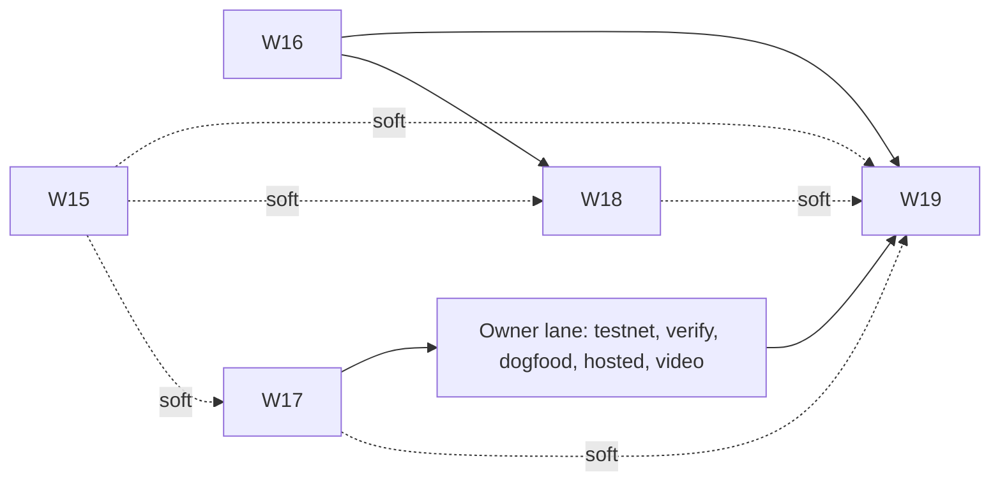

# Final sprint: W15–W19, 2026-11-09 → 2026-11-14 (D9–D14)

This is the cut and calendar for the last sprint. It does for W15–W19 what [HACKATHON_CUT.md](HACKATHON_CUT.md) does for W00–W14, and it replaces that file's calendar from D9 on. Waves follow [PRODUCT_WAVES.md](PRODUCT_WAVES.md) §4–§7: owned paths, contract-first `-01`, one worktree per wave, one agent per issue, S/M only, and an owner check before `main`.

It is based on six parallel checks run on 2026-11-09 against `9418d35` plus the uncommitted landing work:
- the hackathon site
- nearbuilders.org and the NEAR tooling
- a README and gates test run like the screener would
- a tree and architecture review
- a NEAR local-mock inventory
- a spot check of this plan

Owner-only steps are marked **[OWNER]**.

## 1. Facts that set the plan

| Item | Value | Source |
|---|---|---|
| Deadline | **2026-11-14T23:59Z** (unchanged). Our cut-off is **20:00 UTC** | nearhackathon.com/HACKATHON.md |
| Judging | 11-16 → 11-18. Keep the hosted demo up until 11-18, ideally 11-25 (Q-012) | HACKATHON.md |
| Screener | "check that it runs and does what the README says". No rubric is published. do X – see Y, "No marketing" (Q-017) | HACKATHON.md §1, 00-setup.md |
| Video | Required in practice: "screenshots are not enough when judges cannot open the demo" (Q-012) | HACKATHON.md |
| Edits | The **Request changes** page exists. A resubmit returns 409 | /request-changes |
| Competition | 346 submissions: security 169, agents 167, business 60, open 57, privacy 56, swarms 31. About 10 security entries are guard/leash wrappers; none are named audit, review or attest | `/api/projects` |
| nearbuilders.org | Builder directory and project board. Nothing there is judged. Joining gives $10 of NEAR AI credits (Q-000). The X post may tag @NearBuilders | nearbuilders.org/skill.md |

**Pitch:** a guard on its own is a commodity this round. Ours bases its verdict on an **attested multi-model source review of the code the counterparty runs**, and it drops to `warn` when that code changes.

**Tracks:** 06 security (primary), 07 agents (secondary), 13 open (companion). The 03 privacy stretch stays **dropped**: the `nearai:` reviewer family is built (2026-11-12: `audit local --provider nearai`, accounts' own NEAR AI keys), but the TEE attestation check and "Verified" panel (W03-22, W07-22) are not, and reports are stored server-side, so track 03's ask is not met.

## 2. Findings (2026-11-09)

**Green**
- `harness --self-test`
- `npm test` (499/499)
- `audit demo --no-docker`
- the guard attack demo
- `eval:golden`
- `screener-check.sh`
- `test:schemas`, `test:tools`, `test:contract` (86)
- `check:infra`
- the skill copies are identical

**Red: `check:all` stops at step 3** (W16)
- `openapi.json` is stale
- `schema.gen.ts` is stale
- e2e axe contrast
- "BINDING NOT CONFIRMED" is uppercase in the DOM

**The README under-sells the code** (W19). These are built but called missing or stale in the README:
- contract v0.3.0
- the blocklist and the guard reading it
- the near-workspaces suite
- NEP-297 events
- NearBlocks account age
- `GET /api/reports/:id`

There are 11 stale lines in total; `tools/readme-claims.mjs` (W19-02) will enforce this from now on.

**Local NEAR coverage is close to zero** (W15):
- the real contract runs only in `tests/workspaces.rs`
- the web mock (MSW) and the API mock (Postgres) never share state
- `stack:local` builds the web with a real testnet wallet pointed at the nonexistent `review-registry.mock`
- the Postgres mock skips the deposit and storage checks, the `attest` requires, the refund transfer, the bounce and three events
- the guard can never answer `allow` locally (no account-age source)
- `localnet` is rejected, and web `env.ts` requires https

**Not built / not run:**
- testnet (deploy, payment, attestation)
- a hosted demo
- dogfood
- a live golden eval
- a reproducible build / NEP-330
- the `nearai:` TEE attestation check and "Verified" panel (W03-22, W07-22)
- a receipt page
- the `hackathon-submission` tag

## 3. NEAR tools: use, add, skip

| Tool | Decision | Wave |
|---|---|---|
| **near-sandbox** (local node) | **Add:** runs the real wasm in the local stack | W15 |
| near-api-js 7.4.0 | Keep. It also drives the dev wallet, seed and ops scripts | W15 |
| near-connect 0.12.0 | Keep for testnet and mainnet. It cannot target a local node, so the dev wallet replaces it on `sandbox` | W15 |
| near-sdk 5.30.0 → **5.30.1** | Bump (fixes the storage flush, #1669) | W17 |
| **cargo-near 0.23.0** `reproducible-wasm` + **NEP-330** | **Add:** closes the README's own binding limit | W17 |
| NearBlocks "Verify and Publish" / SourceScan | **Add** after the testnet deploy **[OWNER]** | W17 |
| near-workspaces-rs 0.24.0 | Built. Add to CI | W17 |
| near-cli-rs 0.31.1 | Owner deploy and verify | W17, lane O |
| NEP-413, NEP-297 | Built. Shown in the local explorer and the README | W15, W19 |
| NearBlocks API (account age) | Built. A local NearBlocks-shaped stub serves it on `sandbox` | W15 |
| NEAR MCP (`nearai/near-mcp`) | **Add** our own guard MCP server next to it | W18 (H+) |
| market.near.ai | List OmniSwarm **[OWNER]** | lane O |
| `near/agent-skills`, `docs.near.org/llms.txt` | Point to them from AGENTS.md | W19 |
| NEAR AI Cloud (OpenAI-compatible reviewer provider) | **Built** 2026-11-12: `nearai:` family, `--provider nearai`, accounts' own keys. No TEE attestation | docs/providers.md |
| NEAR AI Cloud TEE attestation, NEAR Intents / 1Click, PingPay, Shade Agents (deprecated), Chain Signatures, OutLayer | **Skip** this sprint. Say why in the README | — |

## 4. Waves

| Wave | Name | Demo (owner check) | Depends on | Size (issues) | Agents at peak |
|---|---|---|---|---|---|
| [W15](waves/W15-local-near.md) | Local NEAR | `npm run stack:local` → browser dev wallet → sign → pay → attest on near-sandbox → `/r` **match**. Guard allow/warn/block on live local state. Ops script for every owner method. Mock ↔ contract parity | W08–W10, W13; soft W16-01 | 20 (10 M) | 6 |
| [W16](waves/W16-green-gates.md) | Green gates and landing | `check:all` and `screener-check.sh` green; landing hash = sample attestation | W11, W14 | 7 (S) | 3 |
| [W17](waves/W17-provenance.md) | Code provenance | NEP-330 metadata in the wasm; `near-local verify` match/drift; guard `SOURCE_METADATA_MISMATCH`; NearBlocks verified **[OWNER]** | W10, W13; soft W15 | 10 (1 M) | 3 |
| [W18](waves/W18-agent-economy.md) | Agent economy (H+) | Receipt on `/r/<id>`; guard over MCP from an agent session | W16; soft W15 | 6 (1 M) | 3 |
| [W19](waves/W19-submission-v2.md) | Submission pack v2 | README passes `readme-claims` and the screener; live links; submitted | W16; soft W15, W17, W18 | 10 (2 M) | 4 |

W15, W16 and W17 open **in parallel on D9**. Their owned paths are disjoint; each wave file lists its "Not owned" boundary. Known hand-offs:
- **The two generated API files:** W16-01 regenerates them first; W15-01 regenerates them again after the enum change.
- **`contracts/review-registry/res/**`:** W15 owns it until `wave-15`, then W17-04 rebuilds it reproducibly.
- **`packages/guard/demo/attack/run.mjs`:** W15-09 owns it while W15 is open; W17-08 adds only fixtures and a scenario file.

## 5. Ready and done

**Issue DoR** (an agent may start an issue when):
1. Every issue in **Deps** is merged into the wave branch.
2. The **Owned paths** cell lists every file the issue edits, and no other open issue owns them.
3. The acceptance is a single "do X → see Y" that runs on the developer host without owner keys. Owner-gated steps live in `checks/wNN-check.md`.
4. Any schema, root script or CI change it needs is already landed by the lead (the wave's `-01`).
5. Size is S (≤ ½ day) or M (≤ 1 day).

**Issue DoD:**
1. The acceptance passes and its output is pasted in the issue merge commit body.
2. Tests are added or extended beside the change. For engine-adjacent edits, `node engine/scripts/harness.mjs --self-test && npm test` passes.
3. The wave's track gate is green (`test:intake`, `test:landing`, `test:contract`, `check:infra`, `npm test -w packages/guard`).
4. No file outside its owned paths changed (`git diff --stat` reviewed by the wave lead).
5. No key, `.local/` content, or `reports/` is committed. The gitleaks sweep is clean.
6. Merged `--no-ff` into the wave branch; the issue worktree is removed.

**Wave DoR** and **wave DoD** are in each wave file. All of them require:
- the `-01` contract landed
- the spikes answered
- `check:wNN` reserved
- at the end: `check:wNN` and `check:all` green, the owner check passed, and the tag pushed

## 6. Calendar and agent slots (at most 6 issue agents at once, plus the lead)

| Day | Lead | Agents | Owner |
|---|---|---|---|
| **D9 (11-09)** | W15-00 spike, W15-01 and W15-01b; reserve `check:w15..w19`; W17-01; open the W15, W16 and W17 worktrees | W16-01/04/05 → W16-02/03/06/07; W17-02, W17-05 | Approve this plan; decide on a public repo on D10; **O1a**: testnet accounts and deploy with the current script |
| **D10** | Land W16 (`wave-16`); W19-01; open W19 | W15 group 2 (02, 03, 05, 07, 08, 10), then W15-04 the moment 02/03 land; W17-03, W17-06; W19-02, W19-08 | **O1b** (redeploy reproducible after W17-03), **O2** round trip, **O2b** repo public, **O3** NearBlocks verify |
| **D11** | Go/no-go for W18 at noon. Owner go recorded 2026-11-09: W18 is open (`wave-15` and `wave-16` were already on main) | W15 groups 4–5 (04b, 06, 12, 13 → 09, 11, 14); W17-04, W17-08, W17-09; W19-03/04/06/07 | **O4** dogfood, **O5** hosted demo, (O6 live golden eval) |
| **D12** | Land W15 (`wave-15`), W17 (`wave-17`, then `wave-17.2` with W17-07) | W15-15, W15-16, W15-17; W17-07; W18 if go; W19-05 | **O7** video (includes the local NEAR flow and testnet), **O8** nearbuilders and market.near.ai |
| **D13** | Freeze: only doc and test fixes. Land W18 if green | W19-09 live links | **O9** mainnet payout account, X post |
| **D14** | W19-10 | — | **O10** tag `hackathon-submission`, submit by 20:00 UTC |

## 7. Owner lane O [OWNER]

| Step | What | Blocks |
|---|---|---|
| O1a | Testnet accounts. `bash contracts/review-registry/scripts/deploy-testnet.sh` with the current (non-reproducible) build. Add the function-call operator key, including `report_address`. Put the contract id in the env files | O2, W19-09 |
| O1b | After W17-03: redeploy with `reproducible-wasm`. Account and state are kept | O3 |
| O2 | One real `request_review` → `attest` round trip; `/r/<id>` shows **match** | W19-09 |
| O2b | Make the repo public (recommended for D10: verification, hosted quotes and nearbuilders all need it) | O3, O4 |
| O3 | NearBlocks "Verify and Publish" (or SourceScan) | W19-09 |
| O4 | Dogfood: a real-model review of OmniSwarm at a pinned commit, attested on testnet. Publish the report outside git | W19-09 |
| O5 | Hosted demo up until 11-18, with **no `operator`/`operator` fallback**. Recommended: the scripted preset with a DEMO banner, plus a link to one pre-run real review. Alternative: a real preset with a cost ceiling and rate limit | W19-09 |
| O6 | Optional live golden eval (`OMNI_LIVE=1`) | — |
| O7 | Video, 2–3 minutes: keyless demo → local NEAR flow → testnet attestation on the explorer → guard blocks a prompt-injected payment → `/r` match | W19-09 |
| O8 | Join nearbuilders.org (the $10 credits), add a project entry (`phase: testnet`), list on market.near.ai | — |
| O9 | Mainnet payout account; X post (video, repo, a question, @NEARProtocol #NEARHackathon @NearBuilders) | O10 |
| O10 | Tag `hackathon-submission`, push the tags, submit. Use Request changes for corrections | — |

## 8. Drop order (if behind)

1. Drop W18 entirely.
2. Then W15-16 (browser e2e in CI; the owner check still runs it by hand) and the W15-08 account page.
3. Then the live golden eval (O6).
4. Then W17-07/08 (local verify, metadata attack scenario).
5. **If the W15-00 spike fails** (no darwin-arm64 binary and no Docker image), use **W15-F**:
   - keep W15-01, W15-07, W15-10, W15-13 and W15-14, with the parity test run on Linux CI only
   - fix the Postgres mock to match the contract
   - unify the web and API mocks through the API (the dev wallet signs for real, and the API mock records payments)
   - the owner decides on D9

**Never drop:**
- a green `check:all`
- the README truth-up (`readme-claims` = 0)
- W15-05/07/13/14, so the local flow goes through one honest chain
- the testnet deploy with one attestation
- the video

## 9. Gate before submitting

- [ ] `npm run check:all`, `bash tools/screener-check.sh` and `node tools/readme-claims.mjs` are green on the pushed HEAD
- [ ] `npm run check:w15` is green (or W15-F is done and documented)
- [ ] The contract is deployed on testnet and verified; explorer links are in the README; there is one attested `request_review`
- [ ] The guard reads live state (sandbox and testnet) in the attack demo
- [ ] The hosted URL is up (no default credentials), or the video covers every step
- [ ] `hackathon-submission` is tagged and the compare link resolves
