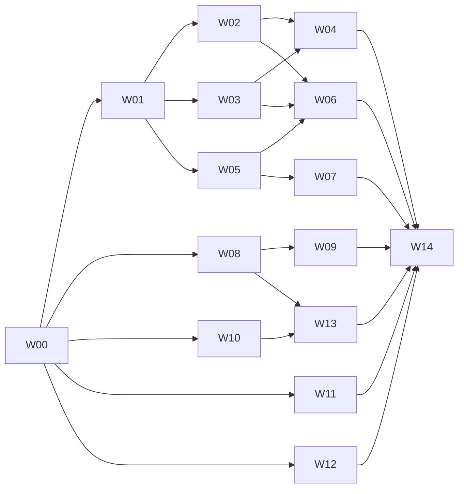

# OmniSwarm — Product Waves (master plan)

> **Status:** v1, 2026-11-02 (hackathon day D2). Plan only. Nothing below is built yet.
> **Inputs:** [`PROJECT_REVIEW.md`](./PROJECT_REVIEW.md) (code review of `main` @ `ac170f1`), [`../hackathon/TRACKS.md`](../hackathon/TRACKS.md) (track fit), [`../spec/ORCHESTRATION.md`](../spec/ORCHESTRATION.md) (reviewer families, iteration budget, debate, report v2), [`../spec/INTAKE.md`](../spec/INTAKE.md) (NEAR login, paid request, queue, attestation), [`../spec/DECISIONS.md`](../spec/DECISIONS.md) (OD-01..).
> **Wave files:** [`waves/`](./waves/) · **Hackathon subset and calendar:** [`HACKATHON_CUT.md`](./HACKATHON_CUT.md) · **Owner check guides:** [`checks/`](./checks/)
> **Reference:** the wave method is borrowed from `../TerraAgent/docs/plan/PRODUCT_WAVES.md` (vertical slices, contract-first, owned paths, one worktree per wave, owner check before `main`).

## 1. The rule

1. **Every wave ships something that runs.** An engine wave ends with a `./bin/audit` command that shows the new behaviour on a fixture; a service wave ends with an endpoint, page or contract method that a check script or e2e drives.
2. **Every wave can be tested on its own.** Each wave has a git tag, a fixture or seed, and its own check (`npm run check:wNN`, a `node --test` file, or an e2e spec).
3. **Waves run in parallel** on six tracks with disjoint owned paths (§4). Cross-track dependencies are **contract-only**: they meet at the JSON Schemas in `packages/schemas/` that W00 lands.
4. **An issue is at most one agent-day.** `S` ≤ ½ day, `M` ≤ 1 day. One acceptance check per issue, written as "do X → see Y". Anything bigger is split.
5. **Every wave is built in its own branch and worktree** and reaches `main` only after the owner's check (§7).
6. **The review boundary does not move.** `scripts/`, `docker/`, `native/` and `skills/` stay the offline review engine. NEAR RPC, wallets, payments, GitHub API calls and the queue live only in `apps/`, `contracts/` and `infra/`. The intake worker runs `./bin/audit run` as a black box with an argv array and never adds a flag that widens a reviewer's permissions (AGENTS.md "Boundaries that the code enforces").

## 2. Layout after W00

| Path | Owner track | What |
|---|---|---|
| `bin/`, `scripts/`, `docker/`, `native/`, `skills/`, `runtime/` | Engine (E) | The review engine. New engine modules stay **flat in `scripts/`** with prefixes (`reviewer-*.mjs`, `provider-*.mjs`, `debate-*.mjs`, `orchestrator-*.mjs`, `report-*.mjs`, `bridge-tools-*.mjs`) so the existing `node --test scripts/*.test.mjs` glob keeps finding their tests |
| `packages/schemas/` | Lead only | JSON Schemas (draft 2020-12) + tiny ESM validators: `reviewer-spec`, `run-config`, `reviewer-report`, `debate-round`, `adjudication`, `general-review`, `job` (intake ↔ engine), `intake-api` DTOs, `attestation` |
| `apps/api/` | Intake (B) | Fastify API + pg-boss worker, TypeScript run directly by Node 24 type stripping (no build step), Postgres |
| `contracts/review-registry/` | Chain (C) | Rust `near-sdk` contract: paid requests, refunds, report attestations, guard blocklist |
| `apps/web/` | Front (F) | Vite + React + TS landing and review app, `@hot-labs/near-connect` |
| `infra/` | Infra (I) | `compose/`, `nginx/`, `systemd/`, `deploy/`, `hosts/` for the remote box |
| `packages/guard/` | Security (S) | `@omniswarm/guard`: agent-side allow/warn/block wrapper (W13), attack demo in `demo/attack/` |
| `eval/golden/` | Engine (E) | Golden fixture repos with seeded bugs and decoys, and the eval runner (W06) |
| `tests/e2e/` | each track its own subfolder | Playwright (`tests/e2e/landing/`), API e2e (`tests/e2e/intake/`), engine e2e (`tests/e2e/engine/`) |
| `tools/` | Lead only | Dev tooling outside the engine: `tools/worktree-env.mjs` (per-worktree ports/DB), `tools/wave.mjs` (`H+`) |
| `docs/plan/`, `docs/spec/`, `docs/hackathon/` | Lead only (wave files: their wave lead) | Plan, specs, submission pack |

`npm test` keeps running only the engine unit tests (CLAUDE.md). New scripts: `npm run test:intake`, `npm run test:landing`, `npm run test:contract`, `npm run test:e2e`, `npm run check:all`.

## 3. Waves

| Wave | Name | Track | The demo (what the owner sees at the check) | Depends on |
|---|---|---|---|---|
| **W00** | Foundation | Spine | Layout, schemas, AGENTS/CLAUDE amendment, baseline tags, CI green, the engine test suite self-contained (257/258 → all green without `runtime/`) | — |
| **W01** | Reviewer Registry | Engine | `./bin/audit run --reviewers cli:claude:opus,cli:codex:gpt-6.1-sol,cli:grok:grok-4.7,cli:agy:gemini-4-argon-high --plan` prints a reviewer × surface matrix; reviewer ids replace the 4 hard-coded adapter names in ~15 places; mid-run crash no longer yields a "finalized" report | W00 |
| **W02** | Sandbox Hardening | Engine | Target tests can no longer replace the bridge's `node`, rewrite the tree reviewers read, or write host control files; each fix has a regression fixture | W01 |
| **W03** | API Reviewers | Engine | `--reviewers key:zai:glm-5.3,openrouter:qwen/qwen3.8-max-0902,scripted:baseline` runs GLM and Qwen through OmniSwarm's own tool loop against the same MCP bridge; `cli:claude-zai:glm-5.3` runs GLM through Claude Code; `scripted:*` runs with no LLM | W01 |
| **W04** | Iteration Budget & Passes | Engine | `--passes 2 --tool-budget 40`: every reviewer, of every family, runs exactly 2 passes, each capped at 40 bridge tool calls, then is forced to submit; `usage.json` shows calls, tokens, cost and stop reason | W02, W03 |
| **W05** | Per-Reviewer Reports | Engine | After a run, `reports/<run>/reviewers/<reviewer-id>/report.{json,md,html}` exists for each model, grouped by family and vendor, and `reviewers/index.json` lists them | W01 |
| **W06** | Orchestrator & Debate | Engine | `--orchestrator recommended` (or a spec) clusters findings, runs anonymized challenge/defend rounds with citation checks, adjudicates with a cross-family judge and writes `general-review.{json,md}`; golden eval shows it against union and majority-vote baselines | W02, W03, W05 |
| **W07** | Report v2 | Engine | `report.html` keeps today's look and adds rail entries **05 Cross-check** and **06 General review**, a per-reviewer page set, a debate timeline per finding, and the PDF export includes them | W05 (W06 output via fixtures until W06 lands) |
| **W08** | Intake API | Intake | `POST /api/challenge → /api/quote → /api/requests` with a real NEP-413 signature verification, GitHub public-repo checks, rate limits and a mock chain port; OpenAPI at `/api/docs` | W00 |
| **W09** | Queue & Worker | Intake | A paid request becomes a pg-boss job; the worker runs `./bin/audit run --github … --ref <sha> --preset hosted` (`--preset hosted`, or `--preset demo` until W03 lands), streams progress, publishes the report and triggers attestation or refund | W08 |
| **W10** | Review Registry (NEAR) | Chain | `review-registry.<owner>.testnet` deployed: `request_review` (payable), `attest`, `refund`, `withdraw`, `get_request`, NEP-297 events; backend `ChainPort` swaps from mock to testnet | W00 |
| **W11** | Landing & Review App | Front | Landing page, "Connect NEAR wallet", submit GitHub URL, sign, pay, live status, report viewer with the on-chain attestation badge, sample report for visitors without a wallet | W00 (mock API until W08/W09 land) |
| **W12** | Remote Host & Deploy | Infra | One remote box: nginx + TLS, Postgres, API in compose, worker as a systemd service next to Docker, provider keys from a root-only env file, backups, one-command SSH deploy, smoke test | W00 |
| **W13** | Agent Guard (track `security`) | Security | `GET /api/guard/verdict?account=…` returns allow/warn/block with reasons from attestations, code-hash drift and the shared blocklist; `@omniswarm/guard` refuses to sign on block and asks a human on warn; a prompt-injected agent tries to pay a known-bad contract and is stopped, with the log | W08, W10 |
| **W14** | Submission Pack | Ops | README in "do X → see Y" form that a screener runs without paid keys (`./bin/audit demo`), RULES.md finalized (v0 lands in W00-19, before debate code), baseline diff section, golden-eval table, video script, X post and form drafts for the owner, hosted demo checked | all `H` waves |

**Spine:** W00 → W01. After W01 the engine splits into W02 ‖ W03 ‖ W05; the service tracks (W08, W10, W11, W12) start right after W00 and do not wait for the engine.

**Critical path:** W00 (3.0 units) → W01 (5.5) → W03 (5.5) → W06 (6.5) → W14 (3.0) = **23.5 units** of chained issues; it fits D2 → D14 only at ≥ 2 units per agent per day ([`HACKATHON_CUT.md`](./HACKATHON_CUT.md) §1 has the pace check and calibration). The hosted path W00 (3.0) → W08 (9.0) → W09 (6.0) → D10 gate = 18 units runs beside it. Totals: 306 issues, **H = 191.5 units**, H+ = 19.

**Soft dependencies** (a hook that lights up when the other wave lands, with a stub until then):
- W07 renders debate and general-review sections from `packages/schemas/` fixtures until W06 lands; W06's e2e re-renders through W07.
- W03-18 (`./bin/audit demo` without Docker) waits for W02 to land, because it adds a `--demo-host` root check to the bridge W02 owns; the rest of W03 does not.
- W06 uses W04's budget counters when present; without W04 it caps debate turns by its own round limit.
- W11 runs on MSW mocks of `intake-api` until W08/W09 land; W11's e2e switches to the real API on the D10 gate.
- W09 runs the `scripted` preset until W03 lands; then the hosted preset (OD-04).
- W13's code-hash drift signal needs W10's attestations; until then it reads the mock chain port.

## 4. Building waves in parallel

| Rule | Detail |
|---|---|
| **Tracks own paths** | Each wave file lists its **owned paths**. Only that wave edits them while it is open. Shared engine files that several waves must touch are split by W01/W02 into **registries** (next row) so later waves add files instead of editing shared ones |
| **Registries, not edits** | W01 turns the orchestrator into a phase list (`scripts/orchestrator-phases.mjs`: `prepare → tests → review → crosscheck → debate → adjudicate → report`); W06 adds `debate` and `adjudicate` as new phase files. W01 turns provider launch into a family registry (`scripts/reviewer-families.mjs` + `provider-<family>.mjs`); W03 adds families as files. W02 turns bridge tools into per-role files (`scripts/bridge-tools-<role>.mjs`); W06 adds `bridge-tools-debate.mjs` and `bridge-tools-orchestrator.mjs`. W07 renders sections from `scripts/report-sections/*.mjs` (W07-01 creates the folder; note the test glob does not recurse, so section tests live as `scripts/report-section-*.test.mjs`) |
| **`docker-agent-orchestrator.mjs` is shared by line range** | W01 owns it while open. After W01 lands: W02 owns only the lifecycle/log lines for R-04 (`:96-112`, `:218-223`, `:346-350` at `ac170f1`); W04 owns the review phase's pass loop; W06 adds phases as files and edits nothing but the phase list. Each later wave merges `main` before touching it |
| **Other shared engine files** | `verify-and-adjudicate.mjs`: W01 (R-05, R-14, R-18b export) → W06 (final statuses). `generate-html-report.mjs`: W01 (R-05 evidence line, R-16 branding, `MODEL_ORDER`) → W07 owns the rest. `report-contract.mjs`: W01 (registry) → W05 (allow-list for `reviewers/`, `debate/`, `general-review.*` in one go). Phase files are named `scripts/orchestrator-phase-<name>.mjs`; W01's registry ships the full list `prepare, tests, review, crosscheck, debate, adjudicate, general-review, report` with no-op stubs for the phases later waves fill |
| **Contract crate hand-off** | `contracts/review-registry/` is W10's. After W10 lands, W13 adds `src/blocklist.rs` (`report_address`, `is_reported`) and W10-12 (`H+`) adds `reviewer_attest`; each merges `main` first |
| **Root scripts** | W00-11 reserves every `check:w00..w14`, `test:*`, `eval:golden` script name and the `packages/*` workspace up front (pointing at a no-op until the wave fills it); `.gitignore` entries (`eval/runs/`) and CI jobs (Rust for W10) are added by the lead in a pre-step |
| **Bridge hook** | W02-03 adds `beforeCall(ctx, name)` in the bridge dispatcher; W04's budget counter and W06's debate roles plug into it instead of editing the dispatcher |
| **AGENTS.md / CLAUDE.md** | Lead only. A wave that changes a boundary (W02 `/src` reads, W03 key policy) files a change request; the lead lands it as a pre-step before the wave's check |
| **Contract-first** | Each wave's `-01` issue lands its schemas or DTOs. The schemas every track shares are written by the lead in W00 (`packages/schemas/`); a wave that needs a schema change files a change request and the lead lands it as a pre-step |
| **Mocks for missing waves** | Chain: `ChainPort` mock (Postgres) until W10. LLMs: `scripted:*` reviewers and a scripted orchestrator. Intake API: MSW handlers generated from `intake-api.schema.json`. GitHub: a recorded-fixture `GitHubPort` |
| **Shared files** | Root `package.json`, `package-lock.json` files, `AGENTS.md`, `CLAUDE.md`, `packages/schemas/**`, `.github/workflows/ci.yml`, `docs/spec/**`: lead only, in a wave pre-step |
| **Both skill copies** | Any wave that changes the reviewer skill edits `skills/security-audit/SKILL.md` and copies it byte-for-byte to `.claude/skills/security-audit/SKILL.md` in the same commit (CLAUDE.md) |
| **Engine guardrails stay green** | Every engine issue ends with `node scripts/harness.mjs --self-test && npm test`; Docker-marked tests only when the sandbox changed (`npm run test:docker`) |

## 5. Issue format

Issue id `WNN-XX`. One row per issue in the wave file:

| Column | Meaning |
|---|---|
| **ID** | `WNN-XX`. `-01` is always the wave's contract (schemas, DTOs, flags); the last issue is always the wave check (e2e or check script + owner check guide + tag) |
| **Title** | Imperative and specific; names files where it helps |
| **Type** | `contract` · `engine` · `server` · `client` · `chain` · `infra` · `test` · `docs` · `security` |
| **Size** | `S` (≤ ½ day) or `M` (≤ 1 day). No L |
| **H** | `H` must for the hackathon · `H+` stretch · blank = after the hackathon. An `H` issue may depend only on `H` issues |
| **Deps** | Issue ids. Ranges (`W03-02..05`) are allowed; inside an `H` issue a range means only the `H` issues in it (an `H` row never waits for an `H+` row). A bare wave id (`W09`) or `WNN <artifact>` means "that wave has landed in `main`" and is allowed only for a wave in the header's **Depends on** or **Soft dependencies**; an issue that waits on a soft dependency lands after that wave is in `main`, as the wave's second landing `wave-NN.2` (W07-20, W11-21, W12-18) |
| **Acceptance** | One "do X → see Y" check |
| **Spec** | Section of a spec or a review finding (`R-01`…) |

Every wave file has: header (track, tag, check command, depends on, owned paths, specs), goal, demo story (the check in words), hackathon slice, features covered, issue table, wave DoD.

## 6. Hackathon

The cut, the calendar, the D10 gate and the drop order are in [`HACKATHON_CUT.md`](./HACKATHON_CUT.md). Track choice is in [`../hackathon/TRACKS.md`](../hackathon/TRACKS.md): **06 `security`** (primary), **07 `agents`**, **13 `open`** (owner-confirmed, OD-01), with **03 `privacy`** as a stretch if the NEAR AI Cloud TEE reviewer's attestation check is green (OD-15) and **05 `swarms`** only if W10's per-reviewer sub-accounts land (OD-02).

## 7. Wave development pipeline

Same pipeline as TerraAgent §7, without its wave tool (W00-16, `H+`, adds a minimal `tools/wave.mjs` only if time allows; the commands below are the source of truth).

| Thing | Name | Example |
|---|---|---|
| Wave branch | `wave/wNN-<slug>` | `wave/w03-api-reviewers` |
| Wave worktree | `../OmniSwarm-wt/wNN` | `../OmniSwarm-wt/w03` |
| Issue branch / worktree | `issue/WNN-XX`, `../OmniSwarm-wt/WNN-XX` | `issue/W03-04` |
| Landing tag | `wave-NN`, then `wave-NN.2` | `wave-03` |

| # | Step | Who | Commands |
|---|---|---|---|
| 1 | **Open** only when every wave in **Depends on** is tagged in `main` | lead agent | `git worktree add ../OmniSwarm-wt/w03 -b wave/w03-api-reviewers main` |
| 2 | **No stacking**: never merge another wave's unlanded branch | — | — |
| 3 | **Build issues**: one issue = one agent = one issue worktree from the wave branch | agent (Claude Code `Agent` with `isolation: "worktree"`, or codex/grok/agy) | `git worktree add ../OmniSwarm-wt/W03-04 -b issue/W03-04 wave/w03-api-reviewers` |
| 4 | **Land an issue** in the wave branch when its gates are green; delete the issue worktree | agent | `git merge --no-ff issue/W03-04` · `git worktree remove ../OmniSwarm-wt/W03-04` · `git branch -d issue/W03-04` |
| 5 | **Ready for check**: merge `main` in, run the wave check and every earlier wave's check, write `checks/wNN-check.md` from the running result | lead agent | `git merge main && npm run check:all && npm run check:w03` |
| 6 | **Owner check** following the guide | **owner** | — |
| 7 | **Land**: merge into `main`, tag, push, remove the worktree; every open wave merges the new `main` | owner, or an agent on the owner's explicit go | `git merge --no-ff wave/w03-api-reviewers -m "W03 API Reviewers" && git tag wave-03 && git push origin main --tags` |

**Gates per track** (step 4):
- Engine: `node scripts/harness.mjs --self-test && npm test` (+ `npm run test:docker` when the sandbox changed).
- Intake: `npm run test:intake` (unit + Postgres integration on a per-worktree database).
- Chain: `npm run test:contract` (`cargo test` + near-workspaces). This is our own contract repo; the CLAUDE.md "no near-sdk `cargo test`" rule is about audited targets inside the sandbox, not about `contracts/` built on the developer host. W00-02 writes that distinction into AGENTS.md.
- Front: `npm run test:landing` (Vitest) + `npm run test:e2e -- landing`.
- Infra: `npm run check:infra` (compose config, shellcheck, nginx -t in a container).

**Isolation per worktree:** `OMNI_PORT_BASE` (API `base+1`, landing `base+173`), database `omniswarm_<branch>` on the shared dev Postgres, written to `.env.worktree`; engine report dirs under `reports/wt-<branch>/`.

**Parallel agent count:** at most one agent per open issue, at most 6 open issues per wave, at most 4 waves open at once on D3–D9 (more than that has collided on shared files in TerraAgent). Real provider calls (`check-agents --live`, paid API keys) happen only in the wave that owns them and only with `OMNI_LIVE=1`.
